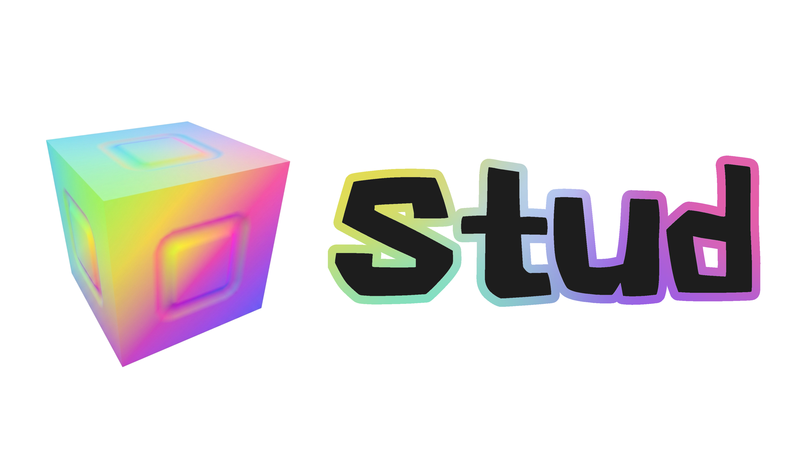
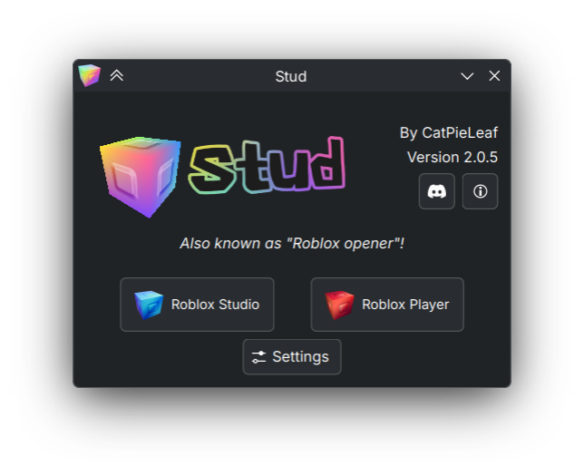
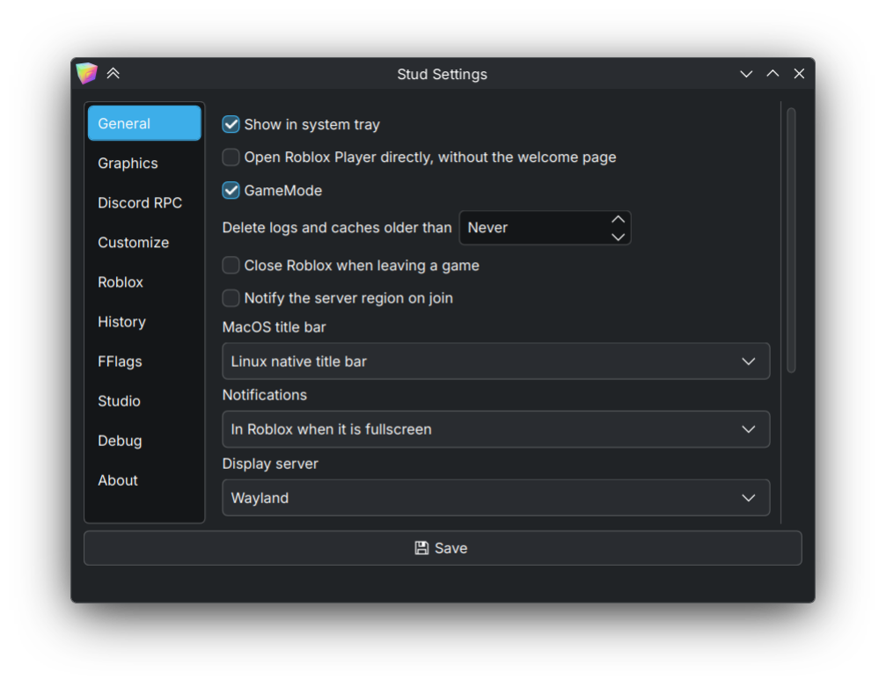
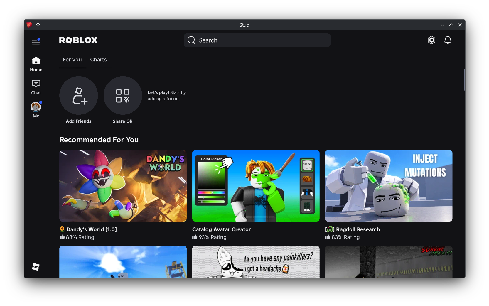
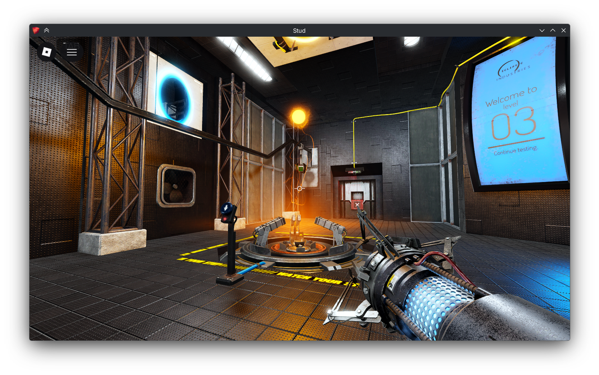
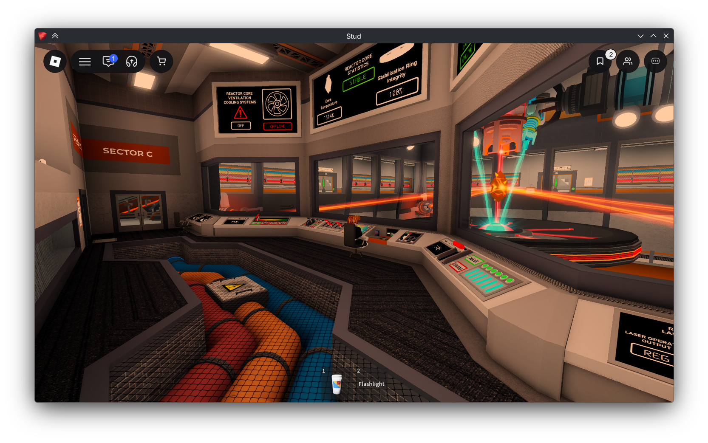
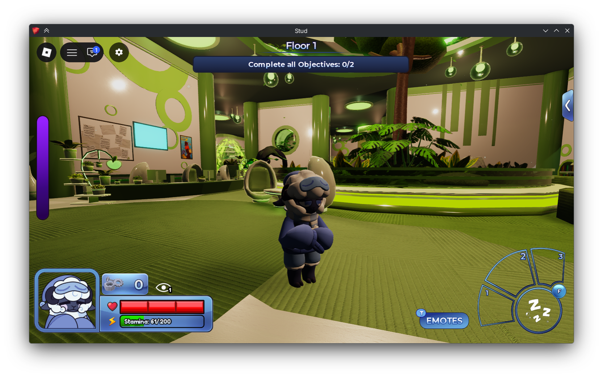
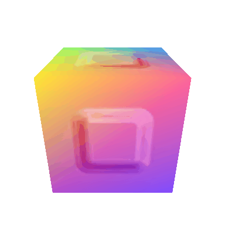

# Stud fork — upstream differences and review ledger

## Baseline and repeatable review process

- Original repository: https://github.com/CatPieLeaf/Stud
- Local reference checkout: `.local/upstream-stud/` (excluded locally from Git;
  not intended for snapshots or distribution). The main repository and branch are untouched.
- Reference commit: `09a4fbc84555d01ba7a8b7dde42bc5839452e28e`.
- Fork under review: `180222da6b77d8cf792a8b40b919dd7156811c1d`, PR #2.
- Rebuild the exhaustive comparison: `python3 tools/report-differences.py`.
- Refresh upstream deliberately with `git -C .local/upstream-stud pull --ff-only`,
  then regenerate; the generated section records the new baseline.
- Each review pass: read new PR reviews and inline comments, verify against source,
  record evidence/reproduction, ask approval, implement only approved changes,
  test, regenerate this file, and commit on the existing branch.
- This file is documentation, not approval to implement findings or ideas.
- Local source/build tooling changes are not automatically commits or PR updates.

## Architecture and porting boundaries

| Area | Responsibility | Fork changes / porting guidance |
|---|---|---|
| `ui/src/main.cpp` | Argument dispatch, session lifecycle, runtime startup, crash handling | Theme initialization and rejection of Studio requests; keep runtime orchestration intact |
| `ui/src/chooser.*` | Launcher home and asynchronous release notes | Replaces product chooser with Player home; keep settings, networking and warnings wired |
| `ui/src/settings_window.*` | Settings pages, validation, persistence, reset actions | Searchable category navigation, spacing, reveals, pending reduced-motion checkbox; retain validation |
| `ui/src/theme.h` | New shared flat stylesheet and motion preference reader | Palette-based surfaces, blue Play accent, separate Qt Interface settings |
| `ui/src/motion.h`, `cube_view.cpp` | Animation primitives and cube display | Stretch/bounce Play, opacity reveals, pulsing skeletons, reduced-motion behavior |
| `ui/src/loading_screen.cpp` | Startup progress window and cancellation UI | Skeleton, headings, percentage hint and slow-operation timer |
| `ui/src/mac_client.*` | Client downloads, extraction, runtime and client management | Shared engine retained, not replaced by the visual redesign |
| `ui/src/github_mirror.*`, `update_check.*` | Mirror-aware HTTP and version checks | Fork metadata endpoints; updates open Releases rather than replacing AppImage |
| `ui/src/desktop_entry.cpp`, `studio_associations.h` | Desktop integration and migration | Player-only entries plus filtering of Stud-owned legacy Studio handlers |
| `stud-config/` | Runtime settings schema, serialization, paths and logs | Existing runtime data model retained; reduced motion stored separately |
| `ui/src/customiz*`, `fflags.*`, `history.*` | Custom content, flags and session history | Features retained, not rewritten by UI work |
| `ui/src/tray.*`, `notifications.*`, `game_activity.*`, `discord_rpc.*` | Session integrations | Shared functionality retained |
| `CMakeLists.txt`, `ui/CMakeLists.txt`, `tests/` | Native build, libraries, regression tests | Studio desktop no longer installed; migration regression test added |
| `.github/workflows/release.yml`, `packaging/build-appimage.sh` | Build, validate, archive and publish | AppImage-only publishing; direct AppImage plus matching sourcecode.zip |
| Other `packaging/` formats | Upstream reference recipes | Not published by fork CI; archive recipes retain upstream URL/checksum/layout pairs |
| `README.md`, `docs/`, AppStream and man page | User and maintainer documentation | Fork distribution, Player-only scope and validation notes |
| `LICENSE*`, `NOTICE.md` | Licensing and attribution | Preserve upstream obligations when transplanting UI |

Do not copy only chooser.cpp onto a new checkout: the theme/motion headers,
settings header, loader, main integration, desktop migration helper, tests,
build/install changes and resources they reference are dependencies. Distribution
changes are separate from UI and should be selected explicitly when porting.
Internal Studio support remains in shared runtime code; Player-only entry points
do not mean all Studio implementation or old user data was deleted.

## Review status — 2026-11-24

CodeRabbit **has published a review of the current HEAD**, submitted at
2026-11-24 04:57:28 UTC. The earlier review was for `5fe676d`; do not confuse
old inline comments with newly discovered regressions. Latest review adds one
outside-diff finding, CR-01 below. No fixes are implemented in this audit pass.
The AppImage run `45329487339` was still building when inspected. A passing
CodeRabbit check is not evidence that compilation or runtime tests passed.

### Approved findings — fixes implemented, runtime verification pending

| ID | Priority / confidence | Evidence and behavior | Proposed verification / fix (not applied) |
|---|---|---|---|
| CR-01 | Minor, source-confirmed | `SettingsWindow::installResets()` omits `reduceMotionCheck_`; Debug's Reset all only iterates `resets_`. Reduced motion stays true despite the “Every setting” message. Also flagged by latest CodeRabbit review. | Register default false; test Reset all and right-click reset, then Save and reopen |
| AUD-01 | Medium, source-confirmed behavior; visual impact untested | `loading_screen.cpp::set_loading_progress()` changes skeleton visibility, then calls `fit()` which sets a fixed window size. Known/unknown progress switches can resize the loader abruptly, contrary to fluid/stable loading goals. | Keep a stable placeholder region; test transition between -1 and numeric progress under throttling |
| AUD-02 | Medium, source-confirmed omission; Linux reproduction pending | Loading window is a plain QWidget; title-bar Close does not call the Cancel button callback. That callback is what sets cancelled, aborts client download and queues quit. Close therefore is not guaranteed equivalent to cancel. | Route Close through one cancellation path; test X/Escape/Cancel with slow download and another visible window |
| AUD-03 | Minor, source-confirmed | `set_loading_progress()` restarts the slow timer on every nonnegative progress report, even if integer percentage did not advance. Frequent tiny progress updates suppress the “taking longer” hint on a very slow transfer. | Define hint as elapsed duration versus no-progress stall; track meaningful advancement and test both cases |
| AUD-04 | Minor, source-confirmed | Release notes request `/releases/tags/<STUD_VERSION>` exactly; updater strips a leading v. A release named v2.0.8 can be detected by update checks while notes request 2.0.8 and fail. | Resolve notes against actual release tag; test both tag conventions and missing release |
| AUD-05 | Low, performance concern | `theme.h::reduced_motion()` constructs QSettings; CubeView calls it on every animated paint. Not proven to cause disk I/O each frame due to Qt caching, but avoidable settings-layer work exists. | Profile before optimizing; consider a cached preference/service refreshed after Save |
| AUD-06 | Medium, inherited robustness concern; fault injection needed | `mac_client.cpp` streaming write tests `< 0` rather than full byte count, and final buffered `file.write()` return is ignored before commit. Short-write coverage is incomplete, though QSaveFile may catch actual I/O errors. | Inject partial writes/full disk and verify corrupt downloads cannot be committed; handle exact write counts |

### End-of-day fixes

User approved fixes for CR-01 and AUD-01 through AUD-06. Applied:
- Registered reduced motion in the reset registry; Save still controls persistence.
- Reserved hidden skeleton space and message heights; loader fitting no longer shrinks.
- Routed title-bar Close, Escape and Cancel through one idempotent queued cancellation.
- Kept the slow hint based on total operation duration, unaffected by tiny progress updates.
- Added one release-note fallback between bare and v-prefixed tags, only for HTTP 404.
- Cached reduced motion on the application; successful Save updates the cache.
- Checked exact byte counts for every streamed and final download write.
- Added an offscreen loader lifecycle test and enabled it alongside desktop migration in CI.

The findings table above retains the original evidence; its proposed fixes have now
been applied. Local dependency-free checks pass; native build, offscreen tests,
manual throttling/full-disk fault injection and Linux visual checks remain pending.
No backlog features were implemented.

These are a source audit, not proof of a crash or a complete security assessment.
No compiled/visual test was possible here because CMake/Qt tooling are absent.
Do not describe the whole codebase as exhaustively tested or bug-free.

### Previous review findings already addressed in 180222d

- Missing Studio desktop file operand blocked AppImage packaging: removed.
- Reference Arch checksum/layout and Flatpak nonexistent fork-tag mismatches:
  restored original matching source recipes (not supported fork download channels).
- Legacy Studio integration: migration helper and regression test added.
- Play had no visible keyboard focus: dashed focus outline added.
- Reduced motion persisted before Save: pending until runtime settings save succeeds.
- Update checks ignored mirror preference: fork metadata checks use get_either again.
- Man page/AppStream still advertised Studio: current descriptions corrected;
  historical release notes retained.

## Feature and UI backlog — proposals only

1. Stable loader geometry and a stage timeline (checking, downloading, preparing, launching).
2. Accessible progress announcements and clear separation of slow transfer versus offline error.
3. Immediate reduced-motion updates to existing animations without restarting.
4. Cached release notes with last-updated time and offline reading.
5. Search individual settings labels/tooltips with highlighted results, not only category names.
6. Unsaved-change indicator and confirmation before discarding edits.
7. Retry launch from an error state while preserving logs and cancellation semantics.
8. Keyboard shortcut legend and complete high-contrast/fractional-scale visual testing.
9. Explicit source/binary version display so testers can identify their build.
10. Focused CI tests for Player argument rejection, loading lifecycle, settings saving,
    reduced-motion reset, tag normalization and desktop migration.

Respect the requested style: existing palette, optional blue accents, no gradients
or glow, restrained fluid/stretch/bounce motion, and Player-only exposed UI.

<!-- generated-comparison -->
## Generated exhaustive file comparison
- Upstream snapshot: `09a4fbc84555d01ba7a8b7dde42bc5839452e28e`
- Fork HEAD: `180222da6b77d8cf792a8b40b919dd7156811c1d` plus working-tree changes.
- Excludes this report to avoid self-recursion, ignored files, Git metadata, and local clones.
- Includes tracked files and non-ignored untracked files; text patches include all changed lines.
- Symlink targets are compared as text. Executable-bit-only changes are not detected.
- Markdown strips trailing whitespace; use Git for a byte-exact applicable patch.
- 37 changed paths; 174 byte-identical paths.

| Path | Change | Upstream bytes | Fork bytes |
|---|---|---:|---:|
| `.github/workflows/release.yml` | modified | 31945 | 3840 |
| `CMakeLists.txt` | modified | 9608 | 9524 |
| `README.md` | modified | 19079 | 3375 |
| `docs/ui-revamp.md` | added | 0 | 3217 |
| `packaging/Packaging.cmake` | modified | 5690 | 5704 |
| `packaging/README.md` | modified | 4003 | 380 |
| `packaging/aur/PKGBUILD.bin` | modified | 1119 | 1133 |
| `packaging/aur/README.md` | modified | 2767 | 380 |
| `packaging/build-appimage.sh` | modified | 14373 | 14079 |
| `packaging/cpak/Containerfile` | modified | 3092 | 3106 |
| `packaging/cpak/Containerfile.prebuilt` | modified | 2745 | 2759 |
| `packaging/cpak/README.md` | modified | 3579 | 380 |
| `packaging/flatpak/README.md` | modified | 3177 | 380 |
| `packaging/io.github.catpieleaf.Stud.desktop` | modified | 792 | 546 |
| `packaging/io.github.catpieleaf.Stud.metainfo.xml` | modified | 21335 | 21124 |
| `packaging/man/stud.1` | modified | 2324 | 2337 |
| `packaging/terra/README.md` | modified | 2250 | 380 |
| `packaging/terra/stud.spec` | modified | 15032 | 15046 |
| `tests/CMakeLists.txt` | modified | 6251 | 6979 |
| `tests/loading_screen_test.cpp` | added | 0 | 2608 |
| `tests/studio_associations_test.cpp` | added | 0 | 1572 |
| `tools/report-differences.py` | added | 0 | 3554 |
| `ui/src/chooser.cpp` | modified | 18966 | 11109 |
| `ui/src/chooser.h` | modified | 354 | 219 |
| `ui/src/cube_view.cpp` | modified | 976 | 1063 |
| `ui/src/desktop_entry.cpp` | modified | 12653 | 13905 |
| `ui/src/loading_screen.cpp` | modified | 5059 | 7502 |
| `ui/src/mac_client.cpp` | modified | 24272 | 24452 |
| `ui/src/main.cpp` | modified | 61493 | 61344 |
| `ui/src/motion.h` | added | 0 | 4654 |
| `ui/src/project_links.cpp` | modified | 1069 | 1083 |
| `ui/src/settings_window.cpp` | modified | 72276 | 74845 |
| `ui/src/settings_window.h` | modified | 3012 | 3047 |
| `ui/src/studio_associations.h` | added | 0 | 1726 |
| `ui/src/theme.h` | added | 0 | 2200 |
| `ui/src/update_check.cpp` | modified | 7977 | 2484 |
| `ui/src/update_check.h` | modified | 1025 | 928 |

## Unchanged paths

- `.containerignore`
- `.dockerignore`
- `.editorconfig`
- `.gitattributes`
- `.github/ISSUE_TEMPLATE/bug_report.yml`
- `.github/ISSUE_TEMPLATE/config.yml`
- `.github/actions/setup/action.yml`
- `.github/get-it-on-cpak.png`
- `.github/get-it-on-cpak.svg`
- `.github/get-it-on-flathub.png`
- `.github/get-it-on-github.png`
- `.github/headers/building.png`
- `.github/headers/contributions.png`
- `.github/headers/credits.png`
- `.github/headers/features.png`
- `.github/headers/howitworks.png`
- `.github/headers/installation.png`
- `.github/headers/screenshots.png`
- `.github/headers/whatstudisnot.png`
- `.github/headers/wherethingslive.png`
- `.github/headers/why.png`
- `.github/icon.png`
- `.github/logo.png`
- `.github/stud-cube.gif`
- `.github/workflows/dependency-cache.yml`
- `.gitignore`
- `AGENTS.md`
- `AI_USAGE_POLICY.md`
- `CONTRIBUTING.md`
- `LICENSE`
- `LICENSE.exception`
- `NOTICE.md`
- `cmake/embed_file.cmake`
- `cmake/stud_commit.cmake`
- `cpak.json`
- `cpak.lock.json`
- `docs/environment.md`
- `flake.lock`
- `flake.nix`
- `packaging/Containerfile.appimage`
- `packaging/aur/.SRCINFO`
- `packaging/aur/.SRCINFO.stud-bin`
- `packaging/aur/PKGBUILD`
- `packaging/aur/PKGBUILD.stud-bin`
- `packaging/debian-copyright`
- `packaging/flatpak/flathub.json`
- `packaging/flatpak/io.github.catpieleaf.Stud.yml`
- `packaging/flatpak/rosemary-cargo-sources.json`
- `packaging/icons/128.png`
- `packaging/icons/16.png`
- `packaging/icons/24.png`
- `packaging/icons/256.png`
- `packaging/icons/32.png`
- `packaging/icons/48.png`
- `packaging/icons/64.png`
- `packaging/icons/stud.svg`
- `packaging/install-desktop-entry.sh`
- `packaging/io.github.catpieleaf.Stud.Player.desktop`
- `packaging/io.github.catpieleaf.Stud.Studio.desktop`
- `packaging/screenshots/home.png`
- `packaging/screenshots/innovationtpp.png`
- `packaging/screenshots/settings.png`
- `packaging/screenshots/studio.png`
- `packaging/screenshots/toonsuniverse.png`
- `packaging/screenshots/tunneler.png`
- `packaging/screenshots/welcome.png`
- `packaging/stud-mime.xml`
- `packaging/stud.png`
- `packaging/terra/anda.hcl`
- `packaging/terra/update.rhai`
- `stud-config/CMakeLists.txt`
- `stud-config/include/stud/session_log.h`
- `stud-config/include/stud/settings.h`
- `stud-config/include/stud/stud_paths.h`
- `stud-config/src/settings.cpp`
- `tests/check.h`
- `tests/client_integrity_test.cpp`
- `tests/code_signature_test.cpp`
- `tests/customization_guard_test.cpp`
- `tests/customization_test.cpp`
- `tests/env_documented_test.cpp`
- `tests/fflags_test.cpp`
- `tests/flatpak_permissions_test.cpp`
- `tests/github_mirror_test.cpp`
- `tests/gpu_enum_test.cpp`
- `tests/launch_uri_test.cpp`
- `tests/log_archive_test.cpp`
- `tests/log_scrub_test.cpp`
- `tests/mono_icon_test.cpp`
- `tests/notifications_test.cpp`
- `tests/release_channel_test.cpp`
- `tests/release_summary_test.py`
- `tests/roblox_settings_test.cpp`
- `tests/settings_test.cpp`
- `tests/stud1_cleanup_test.cpp`
- `tests/zip_extract_test.cpp`
- `tools/README.md`
- `tools/bump-version.py`
- `tools/check-aur-depends.py`
- `tools/check-cpak-runtime.py`
- `tools/compare-package-contents.py`
- `tools/fill-release-checksums.py`
- `tools/flatpak-wpe-cache-key.sh`
- `tools/release-summary.py`
- `tools/update-flatpak-rosemary.sh`
- `tools/validate-payload.py`
- `ui/CMakeLists.txt`
- `ui/resources/apple-root-ca.cer`
- `ui/resources/discord.png`
- `ui/resources/github.png`
- `ui/resources/loading_lines.txt`
- `ui/resources/quotes.txt`
- `ui/resources/resources.qrc`
- `ui/resources/stud-logo-color.png`
- `ui/resources/stud-logo-update.png`
- `ui/resources/stud-title.png`
- `ui/resources/studblu.png`
- `ui/resources/studred.png`
- `ui/src/code_signature.cpp`
- `ui/src/code_signature.h`
- `ui/src/command_warning.cpp`
- `ui/src/command_warning.h`
- `ui/src/cpu_cores.cpp`
- `ui/src/cpu_cores.h`
- `ui/src/cube.cpp`
- `ui/src/cube.h`
- `ui/src/cube_view.h`
- `ui/src/customization.cpp`
- `ui/src/customization.h`
- `ui/src/customize_page.cpp`
- `ui/src/customize_page.h`
- `ui/src/desktop_entry.h`
- `ui/src/diagnose.cpp`
- `ui/src/diagnose.h`
- `ui/src/discord_rpc.cpp`
- `ui/src/discord_rpc.h`
- `ui/src/fflags.cpp`
- `ui/src/fflags.h`
- `ui/src/flatpak_permissions.cpp`
- `ui/src/flatpak_permissions.h`
- `ui/src/game_activity.cpp`
- `ui/src/game_activity.h`
- `ui/src/github_mirror.cpp`
- `ui/src/github_mirror.h`
- `ui/src/gpu_enum.cpp`
- `ui/src/gpu_enum.h`
- `ui/src/history.cpp`
- `ui/src/history.h`
- `ui/src/launch_uri.cpp`
- `ui/src/launch_uri.h`
- `ui/src/launcher_portal.cpp`
- `ui/src/launcher_portal.h`
- `ui/src/loading_screen.h`
- `ui/src/log_archive.cpp`
- `ui/src/log_archive.h`
- `ui/src/log_export.cpp`
- `ui/src/log_export.h`
- `ui/src/log_scrub.h`
- `ui/src/login_keyring.cpp`
- `ui/src/login_keyring.h`
- `ui/src/mac_client.h`
- `ui/src/mono_icon.cpp`
- `ui/src/mono_icon.h`
- `ui/src/notifications.cpp`
- `ui/src/notifications.h`
- `ui/src/open_location.cpp`
- `ui/src/open_location.h`
- `ui/src/project_links.h`
- `ui/src/roblox_settings.cpp`
- `ui/src/roblox_settings.h`
- `ui/src/stud1_cleanup.cpp`
- `ui/src/stud1_cleanup.h`
- `ui/src/tray.cpp`
- `ui/src/tray.h`

## Complete patches

### `.github/workflows/release.yml` (modified)

````diff
--- upstream/.github/workflows/release.yml
+++ fork/.github/workflows/release.yml
@@ -1,398 +1,29 @@
-# Builds Stud and attaches the packages to a release. Runs when a release is
-# published (publish it as a pre-release; the publish job makes it latest once
-# everything is attached). A manual run builds the branch it is started on and
-# keeps the packages as artifacts without uploading or pushing anything.
-
-name: Release
+name: AppImage

 on:
+  push:
+    branches: [main, 'arena/**']
+  pull_request:
+  workflow_dispatch:
   release:
     types: [published]
-  workflow_dispatch:

-# Read-only; only `publish` and the cpak image push need more.
 permissions:
   contents: read

 concurrency:
-  group: release-${{ github.event.release.tag_name || 'main' }}
-  cancel-in-progress: false
+  group: appimage-${{ github.ref }}-${{ github.event_name }}
+  cancel-in-progress: ${{ github.event_name != 'release' }}

 env:
-  # The tag's version, so packages always match their release. Empty on a manual
-  # run; .github/actions/setup fills it in and derives VERSION without the "v".
   TAG: ${{ github.event.release.tag_name }}

 jobs:
-  # Commits the version bump and this release's changelog (from the description's
-  # ## SUMMARY:) on top of the tag and moves the tag there, while the release is
-  # still a pre-release. main is fast-forwarded when it hasn't moved; otherwise
-  # the bump job writes the same files. Does nothing on a manual run but still
-  # runs, since skipping it would skip the build jobs.
-  prepare:
-    name: Release files
-    permissions:
-      contents: write
-    runs-on: ubuntu-latest
-    steps:
-      - uses: actions/checkout@v7
-        if: github.event_name == 'release'
-        with:
-          ref: ${{ env.TAG }}
-
-      - name: Bump the version and write the changelogs
-        if: github.event_name == 'release'
-        env:
-          RELEASE_BODY: ${{ github.event.release.body }}
-          PUBLISHED: ${{ github.event.release.published_at }}
-        run: |
-          printf '%s\n' "$RELEASE_BODY" | python3 tools/release-summary.py \
-            --metainfo "$RUNNER_TEMP/summary.xml" --changelog "$RUNNER_TEMP/summary.txt"
-          python3 tools/bump-version.py "${TAG#v}" --date "${PUBLISHED%%T*}" \
-            --description "$RUNNER_TEMP/summary.xml" --changelog "$RUNNER_TEMP/summary.txt"
-          git diff --stat
-
-      - name: Move the tag onto them
-        # Nothing to commit on a re-run. Edits with this token start no new run.
-        if: github.event_name == 'release'
-        run: |
-          git add -u
-          if git diff --cached --quiet; then
-            echo "$TAG already carries this release's files"
-            exit 0
-          fi
-          git -c user.name="github-actions[bot]" \
-              -c user.email="41898283+github-actions[bot]@users.noreply.github.com" \
-              commit -m "chore: ${TAG#v}"
-          git tag -f "$TAG"
-          git push --force origin "refs/tags/$TAG"
-          git push origin HEAD:refs/heads/main ||
-            echo "main has moved on since $TAG; the last job writes these files to it"
-
-  packages:
-    # fedora:44, the system Stud is tested on, which sets a glibc 2.43 floor.
-    # The rpm, Arch package, Flatpak and cpak image all wrap this one install
-    # tree. The deb builds on Ubuntu and the AppImage on Arch, in their own jobs.
-    name: Build and package
-    permissions:
-      contents: read
-    needs: prepare
-    runs-on: ubuntu-latest
-    container: fedora:44
-    steps:
-      - name: Install build dependencies
-        # Before checkout: the image has no git or tar, which checkout and cache need.
-        run: |
-          dnf install -y --setopt=install_weak_deps=False --setopt=max_parallel_downloads=10 \
-            gcc-c++ cmake ninja-build git pkgconf-pkg-config rpm-build gzip \
-            qt6-qtbase-devel \
-            rust cargo glslc libcurl-devel openssl-devel libsecret-devel zlib-devel systemd-devel libxkbcommon-devel \
-            curl tar xz zstd python3 findutils cpio
-
-      - uses: actions/checkout@v7
-        with:
-          # The released tag, so packages are built from the code it names.
-          ref: ${{ env.TAG || github.sha }}
-
-      - name: Version, Rust and the Cargo cache
-        uses: ./.github/actions/setup
-
-      - name: Build
-        run: |
-          # /usr: the install tree every non-CPack package uses comes from
-          # `cmake --install`, and /usr/local broke namcap and the Flatpak.
-          # Release: no debug info (27 MB of the launcher), symbols kept for crash traces.
-          cmake -S . -B build -G Ninja \
-            -DCMAKE_BUILD_TYPE=Release \
-            -DCMAKE_INSTALL_PREFIX=/usr \
-            -DSTUD_VERSION="${VERSION}"
-          cmake --build build -j"$(nproc)"
-
-      - name: Test
-        # The only build with tests, since the packages come from this tree. Tests
-        # needing a GPU or session bus skip in the container.
-        run: ctest --test-dir build --output-on-failure
-
-      # One install tree for every package, so they can't hold different binaries.
-      - name: Build rpm
-        # The deb builds in its own job against an older Qt.
-        run: cd build && cpack -G RPM
-
-      - name: Stage install tree
-        run: |
-          DESTDIR="$PWD/install-tree" cmake --install build
-          # Fails here, with the reason, instead of later in namcap or the Flatpak build.
-          for required in usr/bin/stud usr/libexec/stud/rosemary usr/share/metainfo; do
-            if [ ! -e "install-tree/$required" ]; then
-              echo "::error::the install tree has no $required, check CMAKE_INSTALL_PREFIX" >&2
-              find install-tree -maxdepth 3 -type d | head -20 >&2
-              exit 1
-            fi
-          done
-          # Rooted at usr/, compressed as the Flatpak manifest's archive source expects.
-          tar -C install-tree -caf "stud-${VERSION}-x86_64.tar.zst" usr
-
-      - name: Validate install tree and rpm
-        # validate-payload checks the tree is complete, counting Rosemary's embedded
-        # upscaler shaders against their sources (a build without glslc succeeds
-        # with useless upscalers). compare-package-contents checks the package
-        # matches the tree byte for byte.
-        run: |
-          python3 tools/validate-payload.py install-tree --label "install tree" \
-            --rosemary-source build/rosemary-prefix/src/rosemary
-          rpm="$(find build -maxdepth 1 -name '*.rpm' | head -1)"
-          [ -n "$rpm" ] || { echo "::error::no rpm was built"; exit 1; }
-          python3 tools/compare-package-contents.py \
-            --tree install-tree --package "$rpm" --kind rpm --work /tmp/rpm-payload
-          python3 tools/validate-payload.py /tmp/rpm-payload --label "rpm"
-
-      - uses: actions/upload-artifact@v7
-        with:
-          name: packages
-          path: |
-            build/*.rpm
-            stud-*-x86_64.tar.zst
-          if-no-files-found: error
-
-  # Needs nothing built, so it reports within a minute of the release starting.
-  flatpak-manifest:
-    name: Flatpak manifest lint
-    permissions:
-      contents: read
-    runs-on: ubuntu-latest
-    steps:
-      - uses: actions/checkout@v7
-        with:
-          ref: ${{ env.TAG || github.sha }}
-
-      - name: Lint Flatpak manifest
-        # Flathub's linter exits 0 on warnings, so errors are read from its JSON.
-        run: |
-          podman run --rm -v "$PWD:/src:z" -w /src \
-            ghcr.io/flathub-infra/flatpak-builder-lint:latest \
-            manifest packaging/flatpak/io.github.catpieleaf.Stud.yml | tee /tmp/flatpak-lint.json
-          python3 - <<'PY'
-          import json, sys
-          # A clean manifest prints nothing at all, not an empty object.
-          text = open("/tmp/flatpak-lint.json").read().strip()
-          report = json.loads(text) if text else {}
-          errors = report.get("errors", [])
-          if not text:
-              print("flatpak-builder-lint: clean, nothing reported")
-          for w in report.get("warnings", []):
-              print(f"::warning::flatpak-builder-lint: {w}")
-          for e in errors:
-              print(f"::error::flatpak-builder-lint: {e}")
-          sys.exit(1 if errors else 0)
-          PY
-
-
-  # Arch package and cpak image, on the runner, where podman is.
-  containers:
-    name: Arch package and cpak image
-    needs: packages
-    runs-on: ubuntu-latest
-    permissions:
-      contents: read
-      packages: write
-    steps:
-      - uses: actions/checkout@v7
-        with:
-          ref: ${{ env.TAG || github.sha }}
-
-      - name: Version
-        uses: ./.github/actions/setup
-        with:
-          rosemary: "false"
-
-      - name: Pull the build images
-        # Registries sometimes return 503 for hours, so images are pulled once with
-        # retries, from a second source if needed, and found locally below. New
-        # images belong in this list.
-        run: |
-          pull() {
-            local attempt
-            for attempt in 1 2 3; do
-              podman pull -q "$1" && return 0
-              [ "$attempt" = 3 ] || sleep $(( attempt * 10 ))
-            done
-            return 1
-          }
-          for pair in docker.io/library/archlinux:base \
-                      docker.io/library/archlinux:latest \
-                      docker.io/library/archlinux:base-devel \
-                      "registry.fedoraproject.org/fedora:44 quay.io/fedora/fedora:44"; do
-            read -r image mirror <<< "$pair"
-            pull "$image" && continue
-            if [ -n "$mirror" ] && pull "$mirror"; then
-              echo "::warning::$image is unavailable, using $mirror"
-              podman tag "$mirror" "$image"
-              continue
-            fi
-            echo "::error::could not pull $image"; exit 1
-          done
-
-      - uses: actions/download-artifact@v8
-        with:
-          name: packages
-          path: artifacts
-
-      - name: Unpack install tree
-        # The release archive is the install tree; no second copy.
-        run: |
-          mkdir -p install-tree
-          archive="$(find artifacts -name 'stud-*-x86_64.tar.zst' | head -1)"
-          [ -n "$archive" ] || { echo "no install tree in the artifacts" >&2; exit 1; }
-          tar -C install-tree -xf "$archive"
-          test -d install-tree/usr
-
-      - name: Build the cpak image, and publish it for a release
-        env:
-          GH_TOKEN: ${{ github.token }}
-          EVENT: ${{ github.event_name }}
-        run: |
-          version="${VERSION}"
-          # Before bin/stud is rebuilt against Arch's Qt below: the cpak image is
-          # Fedora-based and would get a launcher that can't start (#34).
-          python3 tools/check-cpak-runtime.py
-          podman build -f packaging/cpak/Containerfile.prebuilt \
-            -t "ghcr.io/${GITHUB_REPOSITORY_OWNER,,}/stud:${version}" \
-            -t "ghcr.io/${GITHUB_REPOSITORY_OWNER,,}/stud:latest" .
-          # A manual run stops after building; :latest is the newest release's.
-          [ "$EVENT" = release ] || exit 0
-          echo "$GH_TOKEN" | podman login ghcr.io -u "${GITHUB_ACTOR}" --password-stdin
-          # The registry's digest, from the push: podman re-encodes the image.
-          # zstd layers, the base image's too; cpak reads them since its manifest version 3.
-          podman push --compression-format zstd --force-compression --digestfile cpak-image-digest.txt \
-            "ghcr.io/${GITHUB_REPOSITORY_OWNER,,}/stud:${version}"
-          podman push --compression-format zstd --force-compression \
-            "ghcr.io/${GITHUB_REPOSITORY_OWNER,,}/stud:latest"
-          cat cpak-image-digest.txt
-
-      - name: Verify the Arch recipes agree with each other and with the tree
-        # The AUR serves .SRCINFO, so it's regenerated rather than hand-edited.
-        run: |
-          cat > /tmp/srcinfo.sh <<'SCRIPT'
-          #!/bin/bash
-          set -eu
-          pacman -Syu --noconfirm --needed base-devel python binutils >/dev/null
-          useradd -m builder
-          status=0
-          # All three PKGBUILDs describe one package; --tree also names the owner of
-          # each linked library.
-          python3 /work/tools/check-aur-depends.py --tree /work/install-tree || status=1
-          for pair in "PKGBUILD:.SRCINFO" "PKGBUILD.stud-bin:.SRCINFO.stud-bin"; do
-            pkgbuild="/work/packaging/aur/${pair%%:*}"
-            srcinfo="/work/packaging/aur/${pair##*:}"
-            install -o builder -m644 "$pkgbuild" /home/builder/PKGBUILD
-            su builder -c "cd /home/builder && makepkg --printsrcinfo" > /tmp/generated
-            if ! diff -u "$srcinfo" /tmp/generated; then
-              echo "::error::${pair##*:} is stale, regenerate it with: makepkg --printsrcinfo > ${pair##*:}"
-              status=1
-            fi
-          done
-          exit $status
-          SCRIPT
-          chmod +x /tmp/srcinfo.sh
-          podman run --rm -v "$PWD":/work:z -v /tmp/srcinfo.sh:/srcinfo.sh:z \
-            docker.io/library/archlinux:base-devel /srcinfo.sh
-
-      - name: Build the launcher against Arch's own Qt
-        # Arch builds Qt with indirect external access, so a launcher linked against
-        # Fedora's Qt fails with a copy relocation error. Only bin/stud is rebuilt
-        # here (as in the Flatpak); Rosemary links no Qt and is kept.
-        run: |
-          cat > /tmp/qtbuild.sh <<'SCRIPT'
-          #!/bin/bash
-          set -eux
-          # git for fetching miniz.
-          pacman -Syu --noconfirm --needed base-devel cmake ninja git \
-              qt6-base openssl libsecret
-          cmake -S /work -B /tmp/qtonly -G Ninja -DCMAKE_BUILD_TYPE=Release \
-              -DCMAKE_INSTALL_PREFIX=/usr -DSTUD_BUILD_ROSEMARY=OFF -DSTUD_BUILD_TESTS=OFF \
-              -DSTUD_VERSION="$STUD_VERSION"
-          cmake --build /tmp/qtonly -j"$(nproc)"
-          install -m755 /tmp/qtonly/ui/stud-ui /work/install-tree/usr/bin/stud
-          SCRIPT
-          chmod +x /tmp/qtbuild.sh
-          podman run --rm -e STUD_VERSION="${VERSION}" -v "$PWD":/work:z \
-            -v /tmp/qtbuild.sh:/qtbuild.sh:z docker.io/library/archlinux:latest /qtbuild.sh
-          file install-tree/usr/bin/stud
-
-      - name: Build Arch package
-        # makepkg refuses root. It only copies the existing install tree.
-        run: |
-          cp packaging/aur/PKGBUILD.bin "$PWD/PKGBUILD"
-          cat > /tmp/makepkg.sh <<'SCRIPT'
-          #!/bin/bash
-          # Needs a shebang: it's exec'd directly inside the container.
-          set -eux
-          pacman -Syu --noconfirm --needed base-devel zstd
-          useradd -m builder
-          cp /work/PKGBUILD /home/builder/
-          # makepkg's default zstd level is low; 22 packs the same files about a fifth smaller.
-          mkdir -p /home/builder/.config/pacman
-          echo 'COMPRESSZST=(zstd -c -T0 --ultra -22 -)' > /home/builder/.config/pacman/makepkg.conf
-          chown -R builder:builder /home/builder
-          su builder -c "cd /home/builder && STUD_DESTDIR=/work/install-tree PKGEXT=.pkg.tar.zst makepkg --nodeps --noconfirm"
-          cp /home/builder/*.pkg.tar.zst /work/
-          SCRIPT
-          chmod +x /tmp/makepkg.sh
-          podman run --rm -v "$PWD":/work:z -v /tmp/makepkg.sh:/makepkg.sh:z \
-            docker.io/library/archlinux:base-devel /makepkg.sh
-          ls -la ./*.pkg.tar.zst
-
-      - name: Lint Arch package
-        # namcap exits 0 whatever it finds, so errors are read from its output.
-        # Warnings are mostly uninstalled dependencies in a bare container.
-        run: |
-          cat > /tmp/namcap.sh <<'SCRIPT'
-          #!/bin/bash
-          set -eu
-          pacman -Syu --noconfirm --needed namcap >/dev/null
-          pkg=$(find /work -maxdepth 1 -name '*.pkg.tar.zst' | head -1)
-          [ -n "$pkg" ] || { echo "::error::no package for namcap to check"; exit 1; }
-          namcap "$pkg" | tee /tmp/namcap.out || true
-          grep ' E: ' /tmp/namcap.out > /tmp/namcap.errors || true
-          if [ -s /tmp/namcap.errors ]; then
-            sed 's/^/::error::namcap: /' /tmp/namcap.errors
-            exit 1
-          fi
-          SCRIPT
-          chmod +x /tmp/namcap.sh
-          podman run --rm -v "$PWD":/work:z -v /tmp/namcap.sh:/namcap.sh:z \
-            docker.io/library/archlinux:base-devel /namcap.sh
-
-      - name: Validate Arch package contents
-        # Checked against its install tree. Arch moves libexec/stud to lib/stud,
-        # which the comparison maps.
-        run: |
-          pkg="$(find . -maxdepth 1 -name '*.pkg.tar.zst' | head -1)"
-          [ -n "$pkg" ] || { echo "::error::no Arch package was built"; exit 1; }
-          python3 tools/compare-package-contents.py \
-            --tree install-tree --package "$pkg" --kind arch --work /tmp/arch-payload
-          python3 tools/validate-payload.py /tmp/arch-payload --label "Arch package"
-
-      # Separate, since `packages` holds a tar.zst pacman would refuse.
-      - uses: actions/upload-artifact@v7
-        with:
-          name: arch
-          path: "*.pkg.tar.zst"
-          if-no-files-found: error
-
-      - uses: actions/upload-artifact@v7
-        if: github.event_name == 'release'
-        with:
-          name: containers
-          path: cpak-image-digest.txt
-          if-no-files-found: error
-
   appimage:
     # On Arch, which quick-sharun targets. The image bundles glibc, so the base sets no floor.
     name: AppImage
     permissions:
       contents: read
-    needs: prepare
     runs-on: ubuntu-latest
     # The packages Containerfile.appimage installs, so the script needn't start a container.
     container: archlinux:latest
@@ -435,308 +66,40 @@
           chmod +x "$appimage"
           ( cd /tmp && "$OLDPWD/$appimage" --appimage-extract >/dev/null )
           python3 tools/validate-payload.py /tmp/squashfs-root --label "AppImage"
-          # Read from uruntime's ELF section without running the image.
-          readelf -p .upd_info "$appimage" | grep -q 'gh-releases-zsync|CatPieLeaf|Stud|latest|' ||
-            { echo "::error::the AppImage has no update information"; exit 1; }
-          [ -s "$appimage.zsync" ] || { echo "::error::no .zsync next to the AppImage"; exit 1; }
+      - name: Test desktop migration and loading lifecycle
+        run: |
+          cmake -S . -B build-appimage -DSTUD_BUILD_TESTS=ON
+          cmake --build build-appimage --target stud_studio_associations_test stud_loading_screen_test
+          ctest --test-dir build-appimage -R '^(studio_associations|loading_screen)_test$' --output-on-failure --no-tests=error
+
+      - name: Archive matching source code
+        run: git archive --format=zip --prefix=Stud/ --output=build-appimage/packages/sourcecode.zip HEAD

       - uses: actions/upload-artifact@v7
         with:
           name: appimage
           path: |
             build-appimage/packages/*.AppImage
-            build-appimage/packages/*.AppImage.zsync
-          if-no-files-found: error
-
-  deb:
-    # Qt symbols are versioned, so a package runs only on the Qt it was linked
-    # against or newer. Built on ubuntu:26.04, the oldest with Qt 6.9, SDL 3.4 and
-    # glibc 2.43; the step below checks the binary's floor.
-    # Its Rust is too old for Rosemary, so setup installs rustup's stable.
-    name: deb
-    permissions:
-      contents: read
-    needs: prepare
-    runs-on: ubuntu-latest
-    container: ubuntu:26.04
-    env:
-      DEBIAN_FRONTEND: noninteractive
-    steps:
-      - name: Install build dependencies
-        run: |
-          apt-get update
-          apt-get install -y --no-install-recommends \
-            build-essential cmake ninja-build pkg-config git curl ca-certificates \
-            file dpkg-dev tar xz-utils zstd python3 \
-            qt6-base-dev qt6-base-dev-tools libgles-dev \
-            glslc libcurl4-openssl-dev libssl-dev libsecret-1-dev zlib1g-dev libudev-dev libxkbcommon-dev
-
-      - uses: actions/checkout@v7
-        with:
-          ref: ${{ env.TAG || github.sha }}
-
-      - name: Version, Rust and the Cargo cache
-        uses: ./.github/actions/setup
-
-      - name: Build
-        # /usr, as in the packages job.
-        run: |
-          cmake -S . -B build -G Ninja \
-            -DCMAKE_BUILD_TYPE=Release \
-            -DCMAKE_INSTALL_PREFIX=/usr \
-            -DSTUD_BUILD_TESTS=OFF \
-            -DSTUD_VERSION="${VERSION}"
-          cmake --build build -j"$(nproc)"
-
-      - name: Check the Qt floor this build sets
-        # A higher Qt floor than this container's means a stray Qt was linked.
-        run: |
-          have="$(dpkg-query -W -f='${Version}' libqt6core6t64 2>/dev/null || dpkg-query -W -f='${Version}' libqt6core6)"
-          have="Qt_$(echo "$have" | sed 's/^[0-9]*://; s/^\([0-9]*\.[0-9]*\).*/\1/')"
-          floor="$(objdump -p build/ui/stud-ui | grep -o 'Qt_6[._0-9]*' | sort -uV | tail -1)"
-          echo "stud-ui needs $floor; this container carries $have"
-          [ "$(printf '%s\n%s\n' "$floor" "$have" | sort -V | tail -1)" = "$have" ] ||
-            { echo "::error::this build needs $floor, above the $have it was built against"; exit 1; }
-
-      - name: Build deb
-        run: cd build && cpack -G DEB
-
-      - name: Validate deb contents
-        run: |
-          deb="$(find build -maxdepth 1 -name '*.deb' | head -1)"
-          [ -n "$deb" ] || { echo "::error::no deb was built"; exit 1; }
-          DESTDIR="$PWD/deb-tree" cmake --install build --prefix /usr >/dev/null
-          python3 tools/compare-package-contents.py \
-            --tree deb-tree --package "$deb" --kind deb --work /tmp/deb-payload
-          python3 tools/validate-payload.py /tmp/deb-payload --label "deb" \
-            --rosemary-source build/rosemary-prefix/src/rosemary
-          for field in Package Version Architecture Maintainer Description; do
-            value="$(dpkg-deb -f "$deb" "$field")"
-            [ -n "$value" ] || { echo "::error::the deb has no $field field"; exit 1; }
-            echo "$field: $value"
-          done
-          case "$(basename "$deb")" in
-            *_*_*.deb) ;;
-            *) echo "::error::$(basename "$deb") is not <package>_<version>_<arch>.deb"; exit 1 ;;
-          esac
-
-      - uses: actions/upload-artifact@v7
-        with:
-          name: deb
-          path: build/*.deb
-          if-no-files-found: error
-
-  flatpak:
-    # Builds everything itself, Rosemary included. Waits only on the manifest lint,
-    # since a manifest Flathub would reject isn't worth a long build.
-    name: Flatpak bundle
-    permissions:
-      contents: read
-    needs: flatpak-manifest
-    runs-on: ubuntu-latest
-    container:
-      image: ghcr.io/flathub-infra/flatpak-github-actions:kde-6.10
-      options: --privileged
-    steps:
-      - uses: actions/checkout@v7
-        with:
-          ref: ${{ env.TAG || github.sha }}
-
-      - name: Version
-        uses: ./.github/actions/setup
-        with:
-          rosemary: "false"
-
-      - name: Rosemary at the head of the fork's branch
-        # The SDK image has git, curl and python3's venv. Rosemary's commit and its
-        # offline Cargo sources from Cargo.lock; the checkout is kept for the shader check.
-        run: tools/update-flatpak-rosemary.sh "$RUNNER_TEMP/rosemary-flatpak"
-
-      - name: Prepare manifest for local sources
-        # The manifest's tarball digest belongs to one tag, so this builds the
-        # checkout instead. A directory source, since git inside this container
-        # can't resolve HEAD (repository ownership).
-        run: |
-          python3 - <<'PY'
-          import re, sys
-          p = "packaging/flatpak/io.github.catpieleaf.Stud.yml"
-          s = open(p).read()
-          s, n = re.subn(r"      - type: archive\n"
-                         r"        url: https://github\.com/CatPieLeaf/Stud/archive/[^\n]*\n"
-                         r"        sha256: \S+\n",
-                         "      - type: dir\n"
-                         "        path: ../..\n"
-                         "        skip:\n"
-                         "          - .git\n"
-                         "          - .flatpak-builder\n"
-                         "          - build-dir\n"
-                         "          - flatpak-repo\n", s)
-          if n != 1:
-              print(f"::error::expected one source tarball to rewrite, rewrote {n}")
-              sys.exit(1)
-          open(p, "w").write(s)
-          PY
-          grep -n "path: \|url: \|commit: " packaging/flatpak/io.github.catpieleaf.Stud.yml
-
-      - name: Verify no placeholders remain
-        # Checksums are real in the tree, since Flathub builds the manifest as committed.
-        run: |
-          ! grep -q PLACEHOLDER packaging/flatpak/io.github.catpieleaf.Stud.yml
-
-      - name: Work out the WPE cache key
-        # --install-deps-from below fetches the runtime the manifest names, not the image's.
-        run: |
-          flatpak remote-add --if-not-exists --system flathub \
-            https://dl.flathub.org/repo/flathub.flatpakrepo
-          key=$(tools/flatpak-wpe-cache-key.sh)
-          echo "WPE_KEY=$key" >> "$GITHUB_ENV"
-
-      - name: Restore the WPE build
-        # Saved from main by the Dependency cache workflow; on a miss WPE is built here.
-        uses: actions/cache/restore@v6
-        with:
-          path: .flatpak-builder
-          key: ${{ env.WPE_KEY }}
-
-      - name: Build and bundle
-        run: |
-          flatpak-builder --force-clean --disable-rofiles-fuse \
-            --install-deps-from=flathub \
-            --repo=flatpak-repo build-dir \
-            packaging/flatpak/io.github.catpieleaf.Stud.yml
-          flatpak build-bundle flatpak-repo \
-            "stud-${VERSION}-x86_64.flatpak" io.github.catpieleaf.Stud
-
-      - name: Validate Flatpak contents
-        # Rosemary is built here with the SDK's glslc, so its shaders are counted.
-        # The tree is /app, so the desktop-file checks are skipped.
-        run: |
-          python3 tools/validate-payload.py build-dir/files \
-            --label "Flatpak /app" --no-desktop-files \
-            --rosemary-source "$RUNNER_TEMP/rosemary-flatpak/rosemary"
-
-      - uses: actions/upload-artifact@v7
-        with:
-          name: flatpak-bundle
-          path: "*.flatpak"
+            build-appimage/packages/sourcecode.zip
           if-no-files-found: error

   publish:
-    name: Publish
+    if: github.event_name == 'release'
+    needs: appimage
+    runs-on: ubuntu-latest
     permissions:
       contents: write
-    needs: [packages, containers, appimage, deb, flatpak]
-    if: github.event_name == 'release'
-    runs-on: ubuntu-latest
-    # The GitHub CLI lives on the runner.
     steps:
       - uses: actions/download-artifact@v8
         with:
-          path: artifacts
-
-      - name: Upload release assets
+          name: appimage
+          path: packages
+      - name: Attach standalone AppImage and source code
         env:
           GH_TOKEN: ${{ github.token }}
           GH_REPO: ${{ github.repository }}
+          RELEASE_TAG: ${{ github.event.release.tag_name }}
         run: |
-          find artifacts -type f -printf '%f  %s bytes\n'
-          # Found, not assumed: artifact actions have changed where they unpack.
-          mapfile -t packages < <(find artifacts -type f \
-            \( -name '*.rpm' -o -name '*.deb' -o -name '*.AppImage' \
-               -o -name '*.pkg.tar.zst' -o -name 'stud-*-x86_64.tar.zst' \
-               -o -name '*.flatpak' -o -name '*.AppImage.zsync' \))
-          # Every format must be attached.
-          for required in '\.rpm$' '\.deb$' '\.AppImage$' '\.AppImage\.zsync$' '\.flatpak$' '\.pkg\.tar\.zst$'; do
-            printf '%s\n' "${packages[@]}" | grep -qE "$required" ||
-              { echo "no package matching $required" >&2; exit 1; }
-          done
-          gh release upload "$TAG" "${packages[@]}" --clobber
-
-      - name: Make it the latest release
-        # Only now marked latest, so followers of the latest release (Terra's bot)
-        # never see it before its archive exists. Edits with this token start no new run.
-        env:
-          GH_TOKEN: ${{ github.token }}
-          GH_REPO: ${{ github.repository }}
-        run: gh release edit "$TAG" --prerelease=false --latest
-
-  # Commits the version bump and recipe checksums (Flathub, AUR, cpak) to main.
-  # Its own job, so a failure can't undo the upload and can be re-run alone.
-  bump:
-    name: Version and checksums
-    permissions:
-      contents: write
-    needs: publish
-    if: github.event_name == 'release'
-    runs-on: ubuntu-latest
-    # .SRCINFO is regenerated in an archlinux container, and podman is on the runner.
-    steps:
-      - uses: actions/checkout@v7
-        with:
-          ref: main
-
-      - name: Version
-        uses: ./.github/actions/setup
-        with:
-          rosemary: "false"
-
-      - name: Bump the version and write the changelogs
-        # Nothing to do when main was fast-forwarded to prepare's commit.
-        env:
-          RELEASE_BODY: ${{ github.event.release.body }}
-          PUBLISHED: ${{ github.event.release.published_at }}
-        run: |
-          printf '%s\n' "$RELEASE_BODY" | python3 tools/release-summary.py \
-            --metainfo "$RUNNER_TEMP/summary.xml" --changelog "$RUNNER_TEMP/summary.txt"
-          python3 tools/bump-version.py "$VERSION" --date "${PUBLISHED%%T*}" \
-            --description "$RUNNER_TEMP/summary.xml" --changelog "$RUNNER_TEMP/summary.txt"
-
-      - uses: actions/download-artifact@v8
-        with:
-          path: artifacts
-
-      - name: Install cpak
-        # cpak.lock.json can only be written by cpak; checked against the release binary.
-        env:
-          CPAK_VERSION: v2.13.4
-          CPAK_SHA256: 6dd2b082e408e2cd1aa37ae9dd8c9063b593346e8b27b0571ed5c97fe206df2f
-        run: |
-          mkdir -p "$RUNNER_TEMP/bin"
-          curl -fsSL --retry 5 --retry-all-errors -o "$RUNNER_TEMP/bin/cpak" \
-            "https://github.com/Containerpak/cpak/releases/download/$CPAK_VERSION/cpak-linux-amd64"
-          echo "$CPAK_SHA256  $RUNNER_TEMP/bin/cpak" | sha256sum -c -
-          chmod +x "$RUNNER_TEMP/bin/cpak"
-          echo "$RUNNER_TEMP/bin" >> "$GITHUB_PATH"
-
-      - name: Fill in the checksums
-        # From this run's artifacts; the tool downloads GitHub's source tarball.
-        run: |
-          archive_sha="$(find artifacts -name 'stud-*-x86_64.tar.zst' -exec sha256sum {} + | cut -d' ' -f1)"
-          digest="$(find artifacts -name cpak-image-digest.txt -exec cat {} + | cut -d@ -f2)"
-          rm -rf artifacts
-          python3 tools/fill-release-checksums.py "$TAG" \
-            --archive-sha "$archive_sha" --image-digest "$digest"
-          git status --short
-
-      - name: Rosemary in the Flatpak manifest and the flake
-        # The Rosemary commit this release built, so Flathub and Nix build the same one.
-        run: |
-          tools/update-flatpak-rosemary.sh "$RUNNER_TEMP/rosemary-flatpak"
-          podman run --rm -v "$PWD":/work:z -w /work \
-            -e NIX_CONFIG="experimental-features = nix-command flakes" \
-            docker.io/nixos/nix:latest nix flake update rosemary
-          git status --short
-
-      - name: Commit to main
-        run: |
-          git add -u
-          if git diff --cached --quiet; then
-            echo "main already carries this release's version and checksums"
-            exit 0
-          fi
-          # Repository config, since the rebase below commits too.
-          git config user.name "github-actions[bot]"
-          git config user.email "41898283+github-actions[bot]@users.noreply.github.com"
-          git commit -m "chore: $VERSION release checksums"
-          git push origin HEAD:main ||
-            { git pull --rebase origin main && git push origin HEAD:main; }
+          test -f packages/sourcecode.zip
+          test -f packages/Stud-x86_64.AppImage
+          gh release upload "$RELEASE_TAG" packages/sourcecode.zip packages/Stud-x86_64.AppImage --clobber

````

### `CMakeLists.txt` (modified)

````diff
--- upstream/CMakeLists.txt
+++ fork/CMakeLists.txt
@@ -135,7 +135,6 @@
 # Hidden .Player and .Studio entries give the Roblox windows their own taskbar icons.
 install(FILES "${CMAKE_CURRENT_SOURCE_DIR}/packaging/${STUD_APP_ID}.desktop"
               "${CMAKE_CURRENT_SOURCE_DIR}/packaging/${STUD_APP_ID}.Player.desktop"
-              "${CMAKE_CURRENT_SOURCE_DIR}/packaging/${STUD_APP_ID}.Studio.desktop"
         DESTINATION "${CMAKE_INSTALL_DATADIR}/applications")
 install(FILES "${CMAKE_CURRENT_SOURCE_DIR}/packaging/${STUD_APP_ID}.metainfo.xml"
         DESTINATION "${CMAKE_INSTALL_DATADIR}/metainfo")

````

### `README.md` (modified)

````diff
--- upstream/README.md
+++ fork/README.md
@@ -1,394 +1,71 @@
-<div align="center">
-  </img>
-  <br/>
-</div>
+# Stud — Roblox Player for Linux

-<div align="center">
+A Linux-only Roblox Player launcher with a native Qt 6 interface. Based on
+[CatPieLeaf's Stud](https://github.com/CatPieLeaf/Stud), with a redesigned Player
+home, searchable settings categories, animated controls and skeleton loading.
+Studio is not offered by this fork.

-<p align="center">
-  
-  
-  
-  
-  <a href="https://discord.gg/6dmBTA4cJw"></a>
-</p>
+## Download

-  <p align="center">Play Roblox on Linux: the real macOS client, running on your desktop.</p>
-</div>
+**The AppImage from [this repository's releases](https://github.com/vivo6810/stud-with-better-ui-/releases/latest)
+is the only supported launcher download.** No release published yet? Use an
+AppImage artifact from a successful [AppImage workflow run](https://github.com/vivo6810/stud-with-better-ui-/actions/workflows/release.yml).
+Artifacts require a GitHub login and expire according to GitHub retention settings.

-<p align="center">Stud is a <b>launcher</b>. It downloads Roblox's real macOS client from Roblox's own servers and runs it on Linux with <a href="https://github.com/microlift/rosemary">Rosemary</a>. The client is never patched, and Roblox is never shipped from here.</p>
+Download `Stud-x86_64.AppImage`, then:

-<div align="center">
-
-[Screenshots](#screenshots) · [Why?](#why) · [Features](#features) · [Contributions](#contributions) · [What Stud is not](#not)
-
-[How it works](#how) · [Building](#building) · [Installation](#installation) · [Where things live](#files) · [Credits](#credits)
-
-</div>
-
-<br>
-
-<p align="center">
-  <a href="https://github.com/CatPieLeaf/Stud/releases"></a>
-  <a href="https://cpak.it/store/apps/stud"></a>
-  <a href="https://flathub.org/en/apps/io.github.catpieleaf.Stud"></a>
-</p>
-
-<br>
-<div align="center">
-  <h4 id="screenshots"></h4>
-</div>
-
-<table align="center">
-  <tr>
-    <td><a href="packaging/screenshots/welcome.png"></a></td>
-    <td><a href="packaging/screenshots/settings.png"></a></td>
-  </tr>
-</table>
-
-<table align="center">
-  <tr>
-    <td><a href="packaging/screenshots/home.png"></a></td>
-    <td><a href="packaging/screenshots/tunneler.png"></a></td>
-    <td><a href="packaging/screenshots/innovationtpp.png"></a></td>
-    <td><a href="packaging/screenshots/toonsuniverse.png"></a></td>
-  </tr>
-</table>
-
-<br>
-
-<div align="center">
-  <h4 id="why"></h4>
-</div>
-
-I wanted to play Roblox on Linux without it falling over. Sober kept crashing on my NVIDIA machine, and I wanted more control than it gave me: picking my own APK, deciding when Roblox updates, and no OTAs I can't see or turn off.
-
-So I made Stud. The first version ran Roblox's Android client; Stud 2.0 runs the real macOS desktop client instead, on [Rosemary](https://github.com/microlift/rosemary), so it's the full desktop Roblox rather than a phone app on a big screen. Stud fetches the client from Roblox's own servers, keeps it up to date, and gets out of the way.
-
-It's a one-person project, built because I wanted a launcher that stays out of the way. It works for me, and I hope it works for you too.
-
-<br>
-
-<div align="center">
-  <h4 id="features"></h4>
-</div>
-
- - Runs the **real** Roblox macOS client, unpatched: the desktop client, with desktop graphics
- - Downloads and updates the client from Roblox's own servers before each launch, so there is nothing to fetch by hand, and checks its code is still what Roblox shipped. When Roblox puts your account on a test channel, Stud installs that channel's build
- - Two processes: Stud's launcher, and the client on Rosemary
- - Runs on **Wayland and X11**, with Stud's own icon and taskbar entry
- - Your desktop's own title bar, or the macOS one, with or without its menu bar
- - FastFlags: an editor with JSON import, profiles, presets (MSAA, texture quality, graphics level, mesh detail, grass, gray sky), and a warning for flags Roblox ignores, with Clean list
- - Customizations: textures, sounds, fonts and cursors over Roblox's own content, put back when removed; generated cursor, shift lock, emote wheel, death sound and font; import from Bloxstrap, Fishstrap or Froststrap. A new set that crashes Roblox's next start is set aside, and the last set that worked comes back
- - Roblox's own settings (volume, sensitivity, camera, fullscreen and more) editable from Stud
- - Vulkan or OpenGL, with VSync, adaptive VSync, or uncapped with or without tearing
- - **Upscaling** on Vulkan: lower the render resolution and the frame is rebuilt at your window's size. **RAVU-Zoom AR**, with FidelityFX RCAS sharpening after it, is the better picture; **SGSR1 ED** is the lightweight one, for laptops and integrated GPUs
- - Game history with time played, the servers you joined and where they are, rejoining a server, and game shortcuts in the application menu; either kind of history can be turned off
- - Roblox and **Roblox Studio**: opened on its own, Stud asks which, and keeps each up to date. Studio gets its own FastFlags, Ctrl in place of Command in every shortcut, and its Plugins folder one click away
- - `roblox://` links from a browser open straight into the experience, Studio's links reach Studio, and `.rbxl`/`.rbxlx` place files open in Studio
- - Discord Rich Presence as Roblox itself, with the game's name as your status and what the game reports through BloxstrapRPC, an optional Join button, and Studio presence with the place you are developing and whether you are in a script
- - Optional notification of which country the game server is in
- - A frame rate limit for while Roblox is in the background
- - MangoHud and [GameMode](https://github.com/FeralInteractive/gamemode) switches, GPU picker, system tray
- - A launch wrapper (gamescope, prime-run, ...) and your own environment variables for Roblox
- - The AppImage updates itself; the Flatpak names the `flatpak override` command for any permission taken from it
- - Export every session log as one tarball, for when you file a bug; join tickets are kept out of them
-
-<br>
-
-<div align="center">
-  <h4 id="contributions"></h4>
-</div>
-
-**Contributions of any kind are welcome**: code, bug reports, a log from a machine that isn't ours, a GPU we've never tested on, a screenshot of something rendering wrong. Open an [issue](https://github.com/CatPieLeaf/Stud/issues) and say what happened; the tray's **Export logs** puts every session in one file for you.
-
-<br>
-
-<div align="center">
-  <h4 id="not"></h4>
-</div>
-
- - **Not affiliated with Roblox.** Stud is an independent project, not endorsed, supported or approved by Roblox Corporation.
- - **Not a distributor.** No Roblox client is included or mirrored here. Stud downloads it from Roblox's own servers onto your machine, and Roblox remains subject to its own terms.
- - **Not a modding tool.** Stud does not inject code, patch the client, alter game behaviour or give you anything you would not have on a regular client, and it will not gain support for doing so. Requests for that will be ignored and closed.
- - **Not borrowed.** Stud shares no code with Sober or anything like it.
- - **Not an emulator.** There is no virtual machine. Rosemary runs the client's own x86_64 code directly, with the macOS interfaces it expects supplied around it.
-
-<br>
-
-<div align="center">
-  <h4 id="how"></h4>
-</div>
-
-| process | does |
-|---|---|
-| `stud` | settings, deep links, downloading and updating the client, starting it, the tray, reporting a crash |
-| `rosemary` | Roblox's macOS client: its window through SDL3, Metal on Vulkan, its input and sound |
-
-The launcher stays for the whole session as the client's parent, so there is always a process left to say what happened if the client goes down.
-
-<br>
-
-<div align="center">
-  <h4 id="building"></h4>
-</div>
-
-### 1 - Install the system packages
-
-```bash
-sudo dnf install cmake ninja-build gcc-c++ git cargo glslc \
-  qt6-qtbase-devel \
-  libcurl-devel openssl-devel libsecret-devel zlib-devel systemd-devel \
-  libxkbcommon-devel SDL3 wpewebkit
-```
-
-`wpewebkit` comes from [Terra](https://terra.fyralabs.com); Fedora itself does not package WPE WebKit.
-
-<details>
-<summary>Debian / Ubuntu</summary>
-
-```bash
-sudo apt install cmake ninja-build build-essential git glslc \
-  qt6-base-dev \
-  libgles-dev libcurl4-openssl-dev libssl-dev libsecret-1-dev zlib1g-dev libudev-dev libxkbcommon-dev libsdl3-0 \
-  libwpewebkit-2.0-1
-```
-
-Ubuntu has no WPE WebKit 2.0; without it the client's sign-in and web pages stay blank, so use the AppImage or the Flatpak there.
-
-Ubuntu's cargo is older than Rosemary needs; install Rust with [rustup](https://rustup.rs) instead.
-</details>
-
-Rosemary needs Rust 1.99 or newer, and SDL 3.4, FFmpeg and WPE WebKit at runtime. See [its README](https://github.com/microlift/rosemary#building).
-
-### 2 - Build and run
-
-```bash
-cmake -S . -B build -G Ninja
-cmake --build build
-./build/ui/stud-ui
-```
-
-The build fetches Rosemary's source from Stud's fork, [rosemary-stud](https://github.com/CatPieLeaf/rosemary-stud) (branch `stud`: upstream Rosemary with Stud's changes on top), and compiles it. To use a Rosemary you already have, configure with `-DSTUD_BUILD_ROSEMARY=OFF` and put it on `PATH` or in `STUD_ROSEMARY`.
-
-The first launch downloads the macOS client and Rosemary's base system, a few hundred megabytes, then goes straight to Roblox.
-
-<details>
-<summary>Making packages</summary>
-
-```bash
-cd build
-cpack -G RPM                  # build/stud-<version>-1.x86_64.rpm
-cpack -G DEB                  # build/stud_<version>_amd64.deb
-cd ..
-packaging/build-appimage.sh   # build-appimage/packages/Stud-x86_64.AppImage
-```
-
-None of them contains Roblox. The AppImage builds inside a container, so it needs `podman` or `docker`. A deb runs on the distribution that built it and anything newer.
-</details>
-
-<details>
-<summary>Running the tests</summary>
-
-```bash
-ctest --test-dir build
-```
-
-Tests that need a GPU or a notification service report skipped without one. On a desktop, one real "Stud test" notification pops up.
-</details>
-
-<details>
-<summary>Profiling and debugging</summary>
-
-Every debugging switch is listed in [`docs/environment.md`](docs/environment.md).
-</details>
-
-<br>
-
-<div align="center">
-  <h4 id="installation"></h4>
-</div>
-
-Pre-built packages are on the [Releases](https://github.com/CatPieLeaf/Stud/releases) page.
-
-> [!NOTE]
-> **Updating from Stud 1.x:** install 2.0 over it as usual. At its first start Stud removes 1.x's Android engine, APK and caches, which run to gigabytes, and keeps your settings (the ones 2.0 still has), FFlags, customizations and logs. You'll log in to Roblox again, in the new client.
-
-## 🔵 R P M  ( F E D O R A )
-
-Stud is in [Terra](https://terra.fyralabs.com), so it installs and updates like any other package. Add the Terra repository once:
-
-```bash
-sudo dnf install --nogpgcheck --repofrompath 'terra,https://repos.fyralabs.com/terra$releasever' terra-release
-```
-
-Then install Stud:
-
-```bash
-sudo dnf install stud
-```
-
-Or install the rpm from a release by hand. It installs without Terra, but Roblox's sign-in needs WPE WebKit, which only Terra has.
-
-```bash
-sudo dnf install ./stud-*.x86_64.rpm
-```
-
-For that, you'll need to use the command above to add Terra's repository. Then install WPE WebKit:
-
-```bash
-sudo dnf install wpewebkit
-```
-
-## 🟣 D E B  ( D E B I A N  /  U B U N T U )
-
-```bash
-sudo apt install ./stud_*_amd64.deb
-```
-
-Installs and starts on Ubuntu 26.04, Debian 14 and newer, and the Mint releases built on them. On Ubuntu 24.04, Mint 22 or Debian 13, use the AppImage or the Flatpak: Stud 2.0 needs Qt 6.9 and SDL 3.4, which those do not have.
-
-## 🔷 A R C H  ( P A C M A N )
-
-Stud is not on the AUR. Get the package from [Releases](https://github.com/CatPieLeaf/Stud/releases):
-
-```bash
-sudo pacman -U stud-*-x86_64.pkg.tar.zst
-```
-
-To build from source instead, use the PKGBUILD at `packaging/aur/`.
-
-## 🔶 F L A T P A K
-
-Stud is on [Flathub](https://flathub.org/en/apps/io.github.catpieleaf.Stud), so it installs and updates like any other Flatpak:
-
-```bash
-flatpak install flathub io.github.catpieleaf.Stud
-flatpak run io.github.catpieleaf.Stud
-```
-
-Or install the bundle from a release by hand:
-
-```bash
-flatpak install --user ./stud-*-x86_64.flatpak
-```
-
-The manifest is in `packaging/flatpak`.
-
-## ⬛ C P A K
-
-```bash
-cpak install github.com/catpieleaf/stud
-```
-
-[cpak](https://github.com/Containerpak/cpak) installs from an OCI image and runs it rootless. Stud is in the [cpak store](https://cpak.it/store/apps/stud).
-
-## ❄️ N I X
-
-These commands need flakes, which Nix keeps behind a setting. On NixOS, add this to `configuration.nix` and rebuild:
-
-```nix
-nix.settings.experimental-features = [ "nix-command" "flakes" ];
-```
-
-On any other distro, add this line to `~/.config/nix/nix.conf`:
-
-```
-experimental-features = nix-command flakes
-```
-
-Try it without installing:
-
-```bash
-nix run github:CatPieLeaf/Stud
-```
-
-Or install it for your user (`nix profile install` on Nix older than 2.30):
-
-```bash
-nix profile add github:CatPieLeaf/Stud
-```
-
-Or on NixOS, add the flake as an input and install it system-wide:
-
-```nix
-# flake.nix
-{
-  inputs.nixpkgs.url = "github:NixOS/nixpkgs/nixos-unstable";
-  inputs.stud.url = "github:CatPieLeaf/Stud";
-
-  outputs = { nixpkgs, stud, ... }: {
-    nixosConfigurations.nixos = nixpkgs.lib.nixosSystem {
-      modules = [
-        { nixpkgs.overlays = [ stud.overlays.default ]; }
-        ./configuration.nix
-      ];
-    };
-  };
-}
-
-# configuration.nix
-environment.systemPackages = [ pkgs.stud ];
-hardware.graphics.enable = true;
-```
-
-Use your own host name in place of `nixos`. On Nix outside NixOS, run it through [nixGL](https://github.com/nix-community/nixGL) so it can find your graphics driver.
-
-## 🟠 A P P I M A G E  ( A N Y _ D I S T R O )
-
-```bash
+```sh
 chmod +x Stud-x86_64.AppImage
 ./Stud-x86_64.AppImage
 ```

-> [!TIP]
-> Run this once to get a taskbar icon and make `roblox://` links from your browser open Stud:
-> ```bash
-> ./Stud-x86_64.AppImage --install-desktop-entry
-> ```
+Only run builds you trust. This fork's release checks point to this repository, not the upstream project's
+binaries. Update notifications open the release page for manual download.

-> [!NOTE]
-> The rpm and Arch package need glibc 2.43: Fedora 44+ or a current rolling release. The AppImage carries its own glibc, so it's the one to use on anything older.
+## Interface

-<br>
+- Player-only home with keyboard-accessible Play, Settings and release notes.
+- Existing desktop palette, flat surfaces, no glow or gradients; a blue Play accent.
+- Stretch/bounce interactions and smooth page reveals.
+- Reduce motion in General settings; restart to stop all existing animations.
+- Pulsing solid skeletons for pending work, actual download progress when known,
+  slow-loading hints, cancellation and retry for release notes.
+- Existing graphics, customization, history, FFlags and diagnostics retained.

-<div align="center">
-  <h4 id="files"></h4>
-</div>
+Settings categories can be filtered by name. All launcher preferences, including reduced motion, use **Save changes**.

-| path | what |
-|---|---|
-| `~/.config/stud/` | `config.json`, and `flags.json` if you hand-write FFlag overrides; Stud writes them into the client's `ClientAppSettings.json` at launch. `flag-profiles/` holds saved FFlag profiles, and `customizations/` (`studio-customizations/` for Studio) the files laid over Roblox's own content |
-| `~/.local/share/stud/client/` | the macOS client, as Roblox's servers ship it |
-| `~/.local/share/stud/prefix/` | Rosemary's prefix: Roblox's own settings, login and data, and the cookies and cache of the client's web pages |
-| `~/.local/state/stud/logs/` | one log per session, Stud's and the client's. This is the file to read when something goes wrong, and the one to attach to a bug report |
+## How it works

-In a Flatpak these live under the sandbox's own home, so `~/.config/stud/` becomes `~/.var/app/io.github.catpieleaf.Stud/config/stud/` and the rest follow.
+Stud downloads Roblox's unmodified **macOS Player** from Roblox's servers and runs
+it on **Linux through Rosemary**. This is not a Windows or macOS launcher. Roblox
+and the runtime's required downloads are separate from downloading Stud itself.
+No Roblox client is distributed in this repository.

-<br>
+## Build the AppImage

-<div align="center">
-  <h4 id="credits"></h4>
-</div>
+The AppImage workflow runs on pull requests, main and Arena branch pushes, manual
+runs, and published releases. Successful runs prepare `Stud-x86_64.AppImage` and `sourcecode.zip` (the matching
+tracked source, without build dependencies). Published releases attach these two
+files as direct downloads; the AppImage is not wrapped in a ZIP. GitHub also
+adds its own automatic source ZIP/tar.gz links, which cannot be removed.

-Roblox is a trademark of Roblox Corporation. Stud is an independent, non-commercial project and is not affiliated with, endorsed by or supported by them.
+Actions artifacts are still downloaded as ZIP containers by GitHub. For a direct
+AppImage download, use the **Releases** page after a release build succeeds.

- - [Rosemary](https://github.com/microlift/rosemary): runs the macOS client on Linux (GPL-3.0), built from Stud's fork, [rosemary-stud](https://github.com/CatPieLeaf/rosemary-stud)
- - [mpv-prescalers](https://github.com/bjin/mpv-prescalers): the RAVU-Zoom upscaler, compiled into Rosemary (LGPL-3.0-or-later)
- - [Snapdragon Game Super Resolution](https://github.com/SnapdragonStudios/snapdragon-gsr): the SGSR upscaler, compiled into Rosemary (BSD-3-Clause)
- - [AMD FidelityFX Super Resolution 1](https://github.com/GPUOpen-Effects/FidelityFX-FSR): RCAS, the sharpening pass after RAVU, compiled into Rosemary (MIT)
- - [miniz](https://github.com/richgel999/miniz) (MIT)
- - [Bloxstrap](https://github.com/bloxstraplabs/bloxstrap): the classic cursors, character sounds and avatar background, downloaded from its repository when you choose them (MIT)
- - Qt, and on the AppImage the Breeze widget style (LGPL)
- - [Anylinux AppImages](https://github.com/pkgforge-dev/Anylinux-AppImages), [uruntime](https://github.com/VHSgunzo/uruntime) and [sharun](https://github.com/VHSgunzo/sharun): how the AppImage is built and run (MIT)
- - [Boblox Classic](https://www.deviantart.com/ripoof/art/Roblox-Classic-FONT-880246616): the typeface in Stud's logo, by ripoof. The font itself is not shipped
+Locally, with Docker or Podman installed:

-Stud itself is **AGPLv3**, with one additional permission under section 7 ([`LICENSE.exception`](LICENSE.exception)) covering the Roblox client Stud runs but never distributes. Stud is and always will be Open Source.
+```sh
+packaging/build-appimage.sh
+```

-[`NOTICE.md`](NOTICE.md) covers the rest: every third-party licence, trademarks, your Roblox account, and what does and does not leave your machine. A package installs each licence to `/usr/share/licenses/stud/`.
+Outputs are written to `build-appimage/packages/`. The existing Arch-based build
+bundles its dependencies. Internet access is required for build dependencies,
+Rosemary, and AppImage tooling. See `packaging/Containerfile.appimage` for the
+build environment. Native development uses CMake, Ninja, Qt 6 Widgets/DBus/Network,
+OpenSSL, libsecret and the Rosemary build dependencies from that container file.

----
+## Licensing and attribution

-<div align="center">
-  </img>
-</div>
+See [LICENSE](LICENSE), [LICENSE.exception](LICENSE.exception) and [NOTICE.md](NOTICE.md).
+Original Stud by CatPieLeaf; upstream attribution is retained. This fork is not
+an official Roblox product. See [docs/ui-revamp.md](docs/ui-revamp.md) for validation.

````

### `docs/ui-revamp.md` (added)

````diff
--- upstream/docs/ui-revamp.md
+++ fork/docs/ui-revamp.md
@@ -0,0 +1,55 @@
+# Player UI revamp
+
+The launcher home now opens Roblox Player only. Studio command-line requests,
+Studio deep links and place files are rejected before launch. Studio's settings
+tab and installed desktop action are no longer exposed. Shared runtime and
+configuration code are retained to avoid deleting existing user data.
+
+The interface uses the desktop's existing Qt palette, solid surfaces, and a
+small blue Play accent. There are no new gradients, glows or shadows. The Play
+control stretches inside its stable hit target with an OutBack bounce; content
+reveals use an OutCubic opacity transition. Loading skeletons pulse solid fills
+and stop their animation when hidden.
+
+Skeletons represent real pending work, not fabricated game cards. Release notes
+load asynchronously, display a slow-connection hint, and offer Retry on failure.
+The launch screen switches between skeletons for unknown progress and measured
+download progress, retaining cancellation. A prolonged operation is not treated
+as proof of a network failure.
+
+## Validation still required on Linux with Qt 6
+
+- Configure and build using the README's dependencies and run CTest.
+- Open Home, Settings and What's new; verify keyboard navigation and scaling.
+- Play and cancel; retry after cancellation and verify a new launch can succeed.
+- Throttle networking: observe skeletons, slow hint, timeout and Retry in notes.
+- Disconnect networking: verify launching reports the runtime's existing error.
+- Test --studio, roblox-studio links and .rbxl/.rbxlx rejection.
+- Install desktop entries and verify only Player and Settings actions appear.
+- Exercise light/dark palettes and fractional scaling.
+
+The settings interface now has shared flat styling, a category filter, generous
+spacing, page reveals, and a persistent reduced-motion preference in General.
+The preference is stored separately in Qt's Stud/Interface settings after a successful Save; restart
+for all already-running animations to stop. Existing runtime settings and data
+formats are preserved.
+
+The AppImage workflow builds PRs, branch pushes, manual runs and releases;
+only a release event can publish. All launcher update checks point to this fork; updates open its release page.
+Releases attach only the standalone AppImage and matching sourcecode.zip.
+No zsync metadata is published or requested. Legacy package recipes remain as
+reference but the release workflow no longer publishes those formats.
+
+Static checks are recorded in the implementation response. No compiled or visual
+validation was possible because CMake and Qt tooling are absent here. The Linux
+validation checklist above must pass before release.
+
+## Follow-up fixes
+
+Reduced motion participates in Reset all and right-click reset. Its saved value
+is cached for rendering. The loading screen reserves skeleton space, uses one
+cancel path for its button/Close/Escape, and keeps a persistent elapsed-duration
+hint rather than resetting it on every progress report. Release notes try both
+bare and v-prefixed version tags on a missing-tag response. Download writes
+reject short writes before commit. The offscreen loading lifecycle regression
+is part of AppImage CI; native and visual verification remain required.

````

### `packaging/Packaging.cmake` (modified)

````diff
--- upstream/packaging/Packaging.cmake
+++ fork/packaging/Packaging.cmake
@@ -13,7 +13,7 @@
     "Stud runs the real Roblox macOS client on a Linux desktop, on \
 Rosemary. It downloads the client from Roblox's own servers and runs it \
 unmodified. Roblox is not included in this package.")
-set(CPACK_PACKAGE_HOMEPAGE_URL "https://github.com/CatPieLeaf/Stud")
+set(CPACK_PACKAGE_HOMEPAGE_URL "https://github.com/vivo6810/stud-with-better-ui-")
 # "Name <email>", as lintian and rpm expect.
 set(CPACK_PACKAGE_CONTACT "CatPieLeaf <catpieleaf@proton.me>")
 set(CPACK_PACKAGE_VENDOR "CatPieLeaf")

````

### `packaging/README.md` (modified)

````diff
--- upstream/packaging/README.md
+++ fork/packaging/README.md
@@ -1,87 +1,8 @@
-# Packaging
+# Distribution

-One install tree, six formats: the rpm, the deb, the Arch package, the
-AppImage, the Flatpak and the cpak image. `cmake --install` lays down a
-relocatable layout. The deb and the rpm are that tree packaged. The AppImage
-is that tree plus its dependencies.
+This fork distributes only an AppImage through
+[this repository's GitHub releases](https://github.com/vivo6810/stud-with-better-ui-/releases/latest).
+See the root README for installation and the AppImage build workflow.

-```
-<prefix>/bin/stud                     the launcher, the only thing on PATH
-<prefix>/libexec/stud/rosemary        Rosemary, which runs the macOS client
-<prefix>/share/applications/...       desktop entry
-<prefix>/share/metainfo/...           AppStream component
-<prefix>/share/icons/hicolor/...      icon
-<prefix>/share/licenses/stud/...      Stud's licence, and Rosemary's
-```
-
-The launcher finds Rosemary **relative to its own path**, which is what lets
-the same tree work when installed at `/usr` and when mounted at a random path
-by an AppImage. No package contains Roblox: the launcher downloads the macOS
-client from Roblox's own servers at the first start.
-
-## Building the packages
-
-```sh
-cmake -S . -B build -G Ninja
-cmake --build build
-
-cpack -G RPM -B build/packages --config build/CPackConfig.cmake   # Fedora
-cpack -G DEB -B build/packages --config build/CPackConfig.cmake   # Debian/Ubuntu
-packaging/build-appimage.sh                                       # anywhere
-```
-
-The build compiles Rosemary with cargo, from Stud's fork,
-[rosemary-stud](https://github.com/CatPieLeaf/rosemary-stud), branch `stud`.
-It needs Rust 1.99 or newer, git (Rosemary's Microlift dependencies are git
-dependencies), and `glslc` for the upscalers' shaders.
-
-The AppImage builds in an Arch container with [quick-sharun] from the
-[Anylinux AppImages] project. It bundles every library, glibc and mesa
-included, and packs a SquashFS image behind [uruntime].
-
-[quick-sharun]: https://github.com/pkgforge-dev/Anylinux-AppImages/blob/main/useful-tools/quick-sharun.sh
-[Anylinux AppImages]: https://github.com/pkgforge-dev/Anylinux-AppImages
-[uruntime]: https://github.com/VHSgunzo/uruntime
-
-## What is bundled, and what is depended on
-
-**SDL3 is a runtime dependency, and it must be 3.4 or newer.** Rosemary
-opens it by name rather than linking it, so a package names it in its
-dependencies itself; nothing finds it by scanning the binaries. The same
-goes for the Vulkan loader, which the launcher opens to list the GPUs.
-
-The deb and the rpm depend on Qt 6.10 or newer, and on WPE WebKit, which
-Rosemary opens by name to show Roblox's sign-in and web pages. Both only
-recommend it: the rpm's comes from Terra, which plain Fedora lacks, and
-Ubuntu has none, so requiring it would refuse the package there. dnf installs
-it wherever Terra is enabled, and an rpm install without it shows the command
-that adds Terra on Stud's welcome page. The AppImage and the
-Flatpak bundle all of it, down to glibc in the AppImage. That is the ordinary
-split: a system package should use the system's libraries.
-
-GameMode and MangoHud are suggested, not required: both are Settings
-switches, and neither stops Stud from running.
-
-## Appearing in a software centre
-
-Discover, GNOME Software and the rest read AppStream. The component lives
-in `packaging/io.github.catpieleaf.Stud.metainfo.xml` and installs to
-`share/metainfo/<app-id>.metainfo.xml`. A centre hides an application
-whose component is incomplete, so this one carries the lot: reverse-DNS
-id, `desktop-application` type, a launchable pointing at the desktop
-entry, summary, description, licence, URL, OARS content rating.
-
-Three identifiers must agree or the entry does not resolve: the AppStream
-`<id>`, the desktop file's name, and the Wayland `app_id` both of Stud's
-window reports. They all come from `STUD_APP_ID` in the top-level
-`CMakeLists.txt`.
-
-Validate before trusting a package:
-
-```sh
-appstreamcli validate packaging/io.github.catpieleaf.Stud.metainfo.xml
-desktop-file-validate packaging/io.github.catpieleaf.Stud.desktop
-```
-
-Screenshots live in `packaging/screenshots/` and are referenced from the
-component's own `<screenshots>` block in `io.github.catpieleaf.Stud.metainfo.xml`.
+Other packaging recipes are retained as upstream reference material only. They
+are not published or supported download channels for this fork.

````

### `packaging/aur/PKGBUILD.bin` (modified)

````diff
--- upstream/packaging/aur/PKGBUILD.bin
+++ fork/packaging/aur/PKGBUILD.bin
@@ -7,7 +7,7 @@
 pkgrel=1
 pkgdesc="Play and create games on Roblox"
 arch=('x86_64')
-url="https://github.com/CatPieLeaf/Stud"
+url="https://github.com/vivo6810/stud-with-better-ui-"
 license=('AGPL-3.0-or-later')
 # Must match the source PKGBUILD's list.
 depends=(

````

### `packaging/aur/README.md` (modified)

````diff
--- upstream/packaging/aur/README.md
+++ fork/packaging/aur/README.md
@@ -1,62 +1,8 @@
-# AUR packaging
+# Distribution

-Three PKGBUILDs live here, and only one of them is published to the AUR.
+This fork distributes only an AppImage through
+[this repository's GitHub releases](https://github.com/vivo6810/stud-with-better-ui-/releases/latest).
+See the root README for installation and the AppImage build workflow.

-| file | package | what it does |
-|------|---------|--------------|
-| `PKGBUILD.stud-bin` + `.SRCINFO.stud-bin` | **`stud-bin`** | **the AUR package.** Installs the release archive CI built from the tag. |
-| `PKGBUILD` | `stud` | builds from source, for building on your own machine. Not publishable; see below. |
-| `PKGBUILD.bin` | (none) | CI only. Turns an install tree that already exists into a `pkg.tar.zst`. |
-
-They live here rather than only in the AUR repository so the packaging is
-versioned with the code it builds, a dependency added to Stud and not to
-the PKGBUILDs is a broken package, and that is easier to notice in the
-same commit. `stud-bin` and `stud` carry the same `depends` list for the
-same reason.
-
-## Why the source PKGBUILD is not the AUR package
-
-`build()` compiles Rosemary with cargo, and Rosemary's Microlift
-dependencies (and Microlift's wasmtime) are git dependencies that cargo
-fetches while it builds. makepkg fetches what is listed in `source=()` and
-nothing else, and a clean chroot has no network once the build starts, so
-that PKGBUILD builds on a normal machine and fails in `extra-x86_64-build`.
-
-So `stud-bin` is what gets published. It installs prebuilt binaries, which
-is exactly what the `-bin` suffix is for, and it `provides`/`conflicts`
-with `stud` so that building from source instead stays possible.
-
-## Publishing a release
-
-The AUR repository is a separate git repository carrying two files:
-
-```sh
-# Note the release tag has no leading "v" (2.0.8, not v2.0.8); the
-# source URLs above match that, so keep tagging the same way.
-git clone ssh://aur@aur.archlinux.org/stud-bin.git aur-stud
-cp packaging/aur/PKGBUILD.stud-bin aur-stud/PKGBUILD
-cd aur-stud
-# The checksum of the archive the release actually serves. The release
-# workflow prints it too, under "Checksums for the AUR and Flathub
-# repositories".
-updpkgsums
-makepkg --printsrcinfo > .SRCINFO
-makepkg -si          # install it once before pushing it at anyone else
-git commit -am "stud-bin 2.0.8" && git push
-```
-
-`sha256sums` holds the digests of the release named by `pkgver`, filled in
-by `tools/fill-release-checksums.py <version>` once that release exists.
-A checksum belongs to one specific archive, so re-cutting a tag changes it
-and the script has to run again; `updpkgsums` in the clone does the same
-job by hand. `.SRCINFO.stud-bin` is regenerated by the same script, and
-`makepkg --printsrcinfo` above is what generates the one that ships.
-
-## Building from source yourself
-
-```sh
-cd packaging/aur && makepkg -si
-```
-
-It needs network for the whole build: cargo fetches Rosemary's git
-dependencies as it compiles. Compiling Rosemary is most of the time.
+Other packaging recipes are retained as upstream reference material only. They
+are not published or supported download channels for this fork.

````

### `packaging/build-appimage.sh` (modified)

````diff
--- upstream/packaging/build-appimage.sh
+++ fork/packaging/build-appimage.sh
@@ -172,7 +172,7 @@
 # The desktop entry and icons Stud installs, and redistributed licences.
 (cd /usr/share && cp -a --parents \
     "applications/$app_id.desktop" "applications/$app_id.Player.desktop" \
-    "applications/$app_id.Studio.desktop" "metainfo/$app_id.metainfo.xml" "mime/packages/$app_id.xml" \
+    "metainfo/$app_id.metainfo.xml" "mime/packages/$app_id.xml" \
     icons/hicolor/*/apps/"$app_id"*.png licenses/stud doc/stud \
     "$appdir/share/")
 # AppImageHub only reads metainfo from usr/share/metainfo.
@@ -292,10 +292,7 @@
 "$uruntime" --appimage-mksquashfs "$appdir" "$work/image.squashfs" \
     -comp xz -Xbcj x86 -b 1M -all-root -noappend -no-progress -quiet
 cp "$uruntime" "$out"
-# Lets AppImageUpdate update Stud in place from the latest release's .zsync.
-"$out" --appimage-addupdinfo "gh-releases-zsync|CatPieLeaf|Stud|latest|Stud-$arch.AppImage.zsync"
 cat "$work/image.squashfs" >> "$out"
 rm -f "$work/image.squashfs"
-(cd "$packages" && zsyncmake -u "${out##*/}" -o "${out##*/}.zsync" "${out##*/}")

 say "written: $out"

````

### `packaging/cpak/Containerfile` (modified)

````diff
--- upstream/packaging/cpak/Containerfile
+++ fork/packaging/cpak/Containerfile
@@ -63,4 +63,4 @@
 LABEL org.opencontainers.image.title="Stud" \
       org.opencontainers.image.description="Play and create games on Roblox" \
       org.opencontainers.image.licenses="AGPL-3.0-or-later" \
-      org.opencontainers.image.source="https://github.com/CatPieLeaf/Stud"
+      org.opencontainers.image.source="https://github.com/vivo6810/stud-with-better-ui-"

````

### `packaging/cpak/Containerfile.prebuilt` (modified)

````diff
--- upstream/packaging/cpak/Containerfile.prebuilt
+++ fork/packaging/cpak/Containerfile.prebuilt
@@ -54,4 +54,4 @@
 LABEL org.opencontainers.image.title="Stud" \
       org.opencontainers.image.description="Play and create games on Roblox" \
       org.opencontainers.image.licenses="AGPL-3.0-or-later" \
-      org.opencontainers.image.source="https://github.com/CatPieLeaf/Stud"
+      org.opencontainers.image.source="https://github.com/vivo6810/stud-with-better-ui-"

````

### `packaging/cpak/README.md` (modified)

````diff
--- upstream/packaging/cpak/README.md
+++ fork/packaging/cpak/README.md
@@ -1,80 +1,8 @@
-# Stud as a cpak
+# Distribution

-[cpak](https://github.com/Containerpak/cpak) installs an application
-from an OCI image and runs it in a rootless sandbox, with the manifest
-kept in a Git repository. This directory holds both halves: the image,
-and the manifest that says how it may be run.
+This fork distributes only an AppImage through
+[this repository's GitHub releases](https://github.com/vivo6810/stud-with-better-ui-/releases/latest).
+See the root README for installation and the AppImage build workflow.

-## Building the image
-
-The build stage compiles Stud and Rosemary, and Rosemary's cargo build
-fetches its git dependencies, so it needs network. CI does not use this
-file: it builds `Containerfile.prebuilt` from the install tree every other
-package is made from.
-
-```sh
-podman build -f packaging/cpak/Containerfile -t ghcr.io/catpieleaf/stud:2.0.8 .
-podman push ghcr.io/catpieleaf/stud:2.0.8
-```
-
-## Where the manifest lives
-
-`cpak.json` is at the **root of the repository**, not in this directory,
-and it has to be: `cpak install github.com/catpieleaf/stud` fetches that
-one path and nothing else. With it in here the install fails with
-
-    Error: failed to get manifest file: failed to get file content: 404 Not Found
-
-cpak resolves the **default branch** unless told otherwise ("No version
-specified, using the default branch: main"), so a fix to the manifest
-reaches users as soon as it is on `main`. It does not need a new tag or
-a new release. `-r/--release`, `-b/--branch` and `-c/--commit` pick
-something else.
-
-## Publishing the manifest
-
-Manifest v3 requires `image` to be pinned to an immutable digest, so the
-tag above is only the authoring state. `cpak` resolves it:
-
-```sh
-cpak lock cpak.json
-cpak test cpak.json                    # installs temporarily and runs it
-```
-
-The locked `cpak.json` goes at the root of the repository cpak installs
-from (`cpak install github.com/CatPieLeaf/Stud`).
-
-## Why each permission is in the manifest
-
-Nothing here is granted "just in case"; every entry is something Stud
-demonstrably does:
-
-- **`socketWayland`, `deviceDri`**, Rosemary draws the client's window
-  on Wayland through Vulkan and talks to the GPU directly. `displayX11` is
-  deliberately absent.
-- **`deviceShm`**, Rosemary and the client share memory.
-- **`network`**; Roblox.
-- **`socketPulseAudio`**, audio output.
-- **`notification`**, the server-region notification on joining a game
-  (which the user can turn off in Settings), and Stud's own test
-  notification.
-- **`openURI`**, the About tab's repository link.
-- **`clipboard`**, NOT granted. cpak only mediates the X11 clipboard:
-  with a Wayland-only socket it refuses the manifest outright,
-  `clipboard mediation requires displayX11`. Stud is a Wayland
-  application and its clipboard goes through the compositor (the tray
-  shells out to wl-copy), so the grant bought nothing and pulling in
-  displayX11 to keep it would be a far larger permission than the
-  feature is worth.
-- **`filePicker` + `xdg-download` read-only**; customizations and FFlag
-  imports are picked from the user's files (`openFile`), a bootstrapper's
-  folder for the import (`openFolder`), and where exported logs go
-  (`saveFile`). Downloads is where a downloaded one lands. Nothing else of
-  the host's home is visible. A picker cpak refuses answers at once, and
-  Qt's portal dialog misses an answer that quick and waits forever, so
-  every kind of file dialog Stud opens has to be granted.
-- **`sessionBus.talk`** to the system tray's watcher, and **`own`** of
-  `org.kde.StatusNotifierItem-`, for the tray icon. It needs a cpak release
-  with [Containerpak/cpak#78](https://github.com/Containerpak/cpak/pull/78),
-  which lets Qt ask whether the watcher exists and lets the tray host read
-  the icon and menu back; older cpak shows no tray icon.
+Other packaging recipes are retained as upstream reference material only. They
+are not published or supported download channels for this fork.

````

### `packaging/flatpak/README.md` (modified)

````diff
--- upstream/packaging/flatpak/README.md
+++ fork/packaging/flatpak/README.md
@@ -1,68 +1,8 @@
-# Flatpak / Flathub
+# Distribution

-`io.github.catpieleaf.Stud.yml` is the manifest. Flathub wants it in its
-own repository (`flathub/io.github.catpieleaf.Stud`), so this copy is the
-source of truth and that repository carries a copy, the same arrangement
-as `packaging/aur`.
+This fork distributes only an AppImage through
+[this repository's GitHub releases](https://github.com/vivo6810/stud-with-better-ui-/releases/latest).
+See the root README for installation and the AppImage build workflow.

-## Rosemary is built here, offline
-
-Rosemary has to be built against the runtime it runs in: a binary built on
-a newer distribution needs that distribution's glibc, and the runtime's is
-older (Stud 2.0's first Flatpak failed with `GLIBC_2.43 not found`).
-So the manifest builds it from Stud's fork, at the commit it names, with
-the current stable Rust: Rust's own release archive, installed into the
-build directory and never shipped, because Flathub's Rust extension can
-trail the release Rosemary needs (it was 1.98 when Rosemary needed 1.99).
-
-**Flathub builds have no network**, and Rosemary's Microlift dependencies
-(and Microlift's wasmtime) are git dependencies cargo would fetch. So every
-crate and git checkout it needs is listed in `rosemary-cargo-sources.json`,
-generated from that commit's `Cargo.lock` by flatpak-builder-tools'
-`flatpak-cargo-generator.py`. `tools/update-flatpak-rosemary.sh` moves the
-commit to the head of the fork's branch, regenerates the file, and writes
-in the current stable Rust from Rust's channel listing; CI runs
-it before every Flatpak build, and after a release so main carries the
-Rosemary that release built.
-
-## What the manifest builds
-
-- **SDL3.** Rosemary needs SDL 3.4 or newer, and the KDE runtime's SDL3
-  is older, so the manifest builds it. Rosemary opens SDL3 by name, and
-  `/app/lib` is searched before the runtime's.
-- **wl-clipboard**, for copying a server link from the tray menu.
-- **Rosemary**, from the fork, offline, as above. The SDK's `glslc`
-  compiles its upscalers' shaders, and CI counts them in the binary.
-- **The launcher**, with `STUD_BUILD_ROSEMARY=OFF`.
-
-FFmpeg comes from the `org.freedesktop.Platform.ffmpeg-full` extension,
-mounted at `/app/lib/ffmpeg`, because the runtime's own leaves H.264 out.
-Its `version` follows the freedesktop base under the KDE runtime.
-
-## What CI fills in
-
-Stud's own source tarball's checksum, which exists only once the release
-is published, and Rosemary's commit and Cargo sources, as above. Every
-other dependency checksum is real and committed, because Flathub builds the
-manifest exactly as it stands in the tree, a manifest that only works once
-CI has rewritten it is one they cannot build at all.
-
-Changing a dependency's version means changing its checksum in the same
-commit. `flatpak-builder` refuses a mismatch, so a stale one fails the
-build rather than installing the wrong thing.
-
-## Filesystem access
-
-None is requested. Customizations and FFlag imports are chosen through a
-`QFileDialog`, which Qt routes to the file chooser portal inside a sandbox;
-the portal returns a path under `/run/user/<uid>/doc/` that stays readable
-afterwards.
-
-## Testing it locally
-
-```sh
-flatpak install -y flathub org.kde.Sdk//6.11 org.kde.Platform//6.11
-flatpak-builder --force-clean --user --install build-flatpak \
-  packaging/flatpak/io.github.catpieleaf.Stud.yml
-flatpak run io.github.catpieleaf.Stud
-```
+Other packaging recipes are retained as upstream reference material only. They
+are not published or supported download channels for this fork.

````

### `packaging/io.github.catpieleaf.Stud.desktop` (modified)

````diff
--- upstream/packaging/io.github.catpieleaf.Stud.desktop
+++ fork/packaging/io.github.catpieleaf.Stud.desktop
@@ -1,28 +1,23 @@
 [Desktop Entry]
 Type=Application
 Name=Stud
-Comment=Play and create games on Roblox
+Comment=Play Roblox on Linux
 Exec=stud %u
 Icon=io.github.catpieleaf.Stud
 Terminal=false
 StartupNotify=true
 Categories=Game;
-Keywords=roblox;game;gaming;launcher;studio;
+Keywords=roblox;game;gaming;launcher;
 NoDisplay=false
-MimeType=x-scheme-handler/roblox-player;x-scheme-handler/roblox;x-scheme-handler/roblox-studio;x-scheme-handler/roblox-studio-auth;application/x-roblox-rbxl;application/x-roblox-rbxlx;
+MimeType=x-scheme-handler/roblox-player;x-scheme-handler/roblox;
 StartupWMClass=io.github.catpieleaf.Stud
-Actions=Roblox;Studio;Settings;
+Actions=Roblox;Settings;

 [Desktop Action Roblox]
 Name=Roblox Player
 Exec=stud --roblox
 Icon=io.github.catpieleaf.Stud-player

-[Desktop Action Studio]
-Name=Roblox Studio
-Exec=stud --studio
-Icon=io.github.catpieleaf.Stud-studio
-
 [Desktop Action Settings]
 Name=Settings
 Exec=stud --settings

````

### `packaging/io.github.catpieleaf.Stud.metainfo.xml` (modified)

````diff
--- upstream/packaging/io.github.catpieleaf.Stud.metainfo.xml
+++ fork/packaging/io.github.catpieleaf.Stud.metainfo.xml
@@ -7,10 +7,10 @@
   <project_license>AGPL-3.0-or-later</project_license>

   <name>Stud</name>
-  <summary>Play and create games on Roblox</summary>
+  <summary>Play Roblox on Linux</summary>

   <description>
-    <p>Stud runs the macOS Roblox Player and Studio on Linux through Rosemary.</p>
+    <p>Stud runs the macOS Roblox Player on Linux through Rosemary. This launcher does not support Studio.</p>
     <p>Features:</p>
     <ul>
       <li>Updates Roblox from Roblox's own servers before each launch</li>
@@ -31,7 +31,6 @@
     <keyword>game</keyword>
     <keyword>gaming</keyword>
     <keyword>launcher</keyword>
-    <keyword>studio</keyword>
   </keywords>

   <screenshots>
@@ -40,10 +39,6 @@
       <image type="source" width="1666" height="1043">https://raw.githubusercontent.com/CatPieLeaf/Stud/main/packaging/screenshots/home.png</image>
     </screenshot>
     <screenshot>
-      <caption>Roblox Studio running on Stud</caption>
-      <image type="source" width="1763" height="1098">https://raw.githubusercontent.com/CatPieLeaf/Stud/main/packaging/screenshots/studio.png</image>
-    </screenshot>
-    <screenshot>
       <caption>The "Tunneler" game on Roblox</caption>
       <image type="source" width="1666" height="1043">https://raw.githubusercontent.com/CatPieLeaf/Stud/main/packaging/screenshots/tunneler.png</image>
     </screenshot>
@@ -65,9 +60,9 @@
     </screenshot>
   </screenshots>

-  <url type="homepage">https://github.com/CatPieLeaf/Stud</url>
-  <url type="bugtracker">https://github.com/CatPieLeaf/Stud/issues</url>
-  <url type="vcs-browser">https://github.com/CatPieLeaf/Stud</url>
+  <url type="homepage">https://github.com/vivo6810/stud-with-better-ui-</url>
+  <url type="bugtracker">https://github.com/vivo6810/stud-with-better-ui-/issues</url>
+  <url type="vcs-browser">https://github.com/vivo6810/stud-with-better-ui-</url>

   <developer id="io.github.catpieleaf">
     <name>CatPieLeaf</name>

````

### `packaging/man/stud.1` (modified)

````diff
--- upstream/packaging/man/stud.1
+++ fork/packaging/man/stud.1
@@ -6,7 +6,7 @@
 .RI [ URI ]
 .br
 .B stud
-.RB [ \-\-roblox | \-\-studio ]
+.RB [ \-\-roblox ]
 .br
 .B stud \-\-settings
 .br
@@ -22,21 +22,20 @@
 and keeps it up to date before each launch, and Roblox remains subject to its
 own terms.
 .PP
-Run with no arguments, Stud asks whether to open Roblox or Roblox Studio.
+Run with no arguments, Stud opens the Roblox Player launcher home.
 Given a
-.BR roblox: ,
+.B roblox:
+or
 .B roblox\-player:
-or
-.B roblox\-studio:
-URI \- what a browser hands over when you press Play or Edit on the website \-
-it opens straight into that experience.
+URI, it opens straight into that experience.
+Roblox Studio, Studio URIs and place files are not supported by this launcher.
 .SH OPTIONS
 .TP
 .B \-\-roblox
 Open Roblox without asking.
 .TP
 .B \-\-studio
-Open Roblox Studio without asking.
+Not supported. Displays a Player-only message and exits with status 1.
 .TP
 .B \-\-settings
 Open the Settings window on its own, without launching the client. This is
@@ -68,7 +67,7 @@
 One log per session, Stud's and the client's.
 .SH BUGS
 Report at
-.UR https://github.com/CatPieLeaf/Stud/issues
+.UR https://github.com/vivo6810/stud-with-better-ui-/issues
 .UE .
 .PP
 Stud is free software under the GNU Affero General Public License, version 3

````

### `packaging/terra/README.md` (modified)

````diff
--- upstream/packaging/terra/README.md
+++ fork/packaging/terra/README.md
@@ -1,50 +1,8 @@
-# Terra packaging
+# Distribution

-[Terra](https://terra.fyralabs.com/) is a third-party Fedora repository for
-packages Fedora's own guidelines cannot take. Stud is one of those: Fedora
-requires every binary to be built from source in the source package, and
-forbids removing that requirement for bundled prebuilts, while Stud ships
-Rosemary, whose build fetches its git dependencies and so cannot run
-without network access. Terra
-publishes AppStream metadata, so a package here appears in KDE Discover and
-GNOME Software with its icon, description and screenshots.
+This fork distributes only an AppImage through
+[this repository's GitHub releases](https://github.com/vivo6810/stud-with-better-ui-/releases/latest).
+See the root README for installation and the AppImage build workflow.

-| file | what it is |
-|------|------------|
-| `stud.spec` | the package. Installs the release archive CI built from the tag. |
-| `anda.hcl` | Terra's own build description, naming the spec and the arch. |
-| `update.rhai` | how Terra's bot finds a new version (the GitHub release). |
-
-They live here rather than only in Terra's repository for the same reason the
-PKGBUILDs do: a dependency added to Stud and not to the packaging is a broken
-package, and that is easier to notice in the same commit.
-
-## Submitting
-
-Terra's packages live in one monorepo, a directory per package:
-
-```sh
-git clone https://github.com/terrapkg/packages
-mkdir -p packages/anda/games/stud
-cp packaging/terra/{stud.spec,anda.hcl,update.rhai} packages/anda/games/stud/
-```
-
-then open a pull request against `frawhide`.
-
-Two of their policies are worth reading before you do
-(<https://docs.terrapkg.com/contributing/policies>): you must have the right
-to redistribute what you package, which Stud satisfies because it is AGPL and
-ships none of Roblox's own files; and their AI policy asks that spec files not
-be generated by an LLM and that any LLM help be disclosed in the pull request.
-
-## Why nothing is compiled
-
-`%build` is empty on purpose. Rosemary's Cargo build fetches Microlift and
-its other git dependencies, and no build system worth using has network
-during a build. `packaging/aur/README.md` explains this at length for the
-same reason.
-
-Rosemary opens SDL3 and FFmpeg by name rather than linking them, so rpm's
-scan of the binaries cannot see either: the spec requires both itself, SDL3
-3.4 or newer and FFmpeg by the `libavcodec-free` and `libavutil-free` names
-Fedora's build and RPM Fusion's both provide.
+Other packaging recipes are retained as upstream reference material only. They
+are not published or supported download channels for this fork.

````

### `packaging/terra/stud.spec` (modified)

````diff
--- upstream/packaging/terra/stud.spec
+++ fork/packaging/terra/stud.spec
@@ -8,7 +8,7 @@
 Summary:        Play and create games on Roblox

 License:        AGPL-3.0-or-later
-URL:            https://github.com/CatPieLeaf/Stud
+URL:            https://github.com/vivo6810/stud-with-better-ui-
 Source0:        %{url}/releases/download/%{version}/stud-%{version}-x86_64.tar.zst
 Packager:       CatPieLeaf <catpieleaf@proton.me>


````

### `tests/CMakeLists.txt` (modified)

````diff
--- upstream/tests/CMakeLists.txt
+++ fork/tests/CMakeLists.txt
@@ -1,4 +1,15 @@
 if(STUD_BUILD_UI)
+    add_executable(stud_loading_screen_test loading_screen_test.cpp
+        ../ui/src/loading_screen.cpp ../ui/src/cube_view.cpp ../ui/src/cube.cpp)
+    target_link_libraries(stud_loading_screen_test PRIVATE stud_ui_mac_client Qt6::Widgets)
+    add_test(NAME loading_screen_test COMMAND stud_loading_screen_test)
+    set_tests_properties(loading_screen_test PROPERTIES ENVIRONMENT "QT_QPA_PLATFORM=offscreen")
+
+    add_executable(stud_studio_associations_test studio_associations_test.cpp)
+    target_include_directories(stud_studio_associations_test PRIVATE ../ui/src)
+    target_link_libraries(stud_studio_associations_test PRIVATE Qt6::Core)
+    add_test(NAME studio_associations_test COMMAND stud_studio_associations_test)
+
     find_package(Qt6 REQUIRED COMPONENTS DBus)
     # These need desktop services and skip without them, e.g. in a chroot or CI container.
     add_executable(stud_gpu_enum_test gpu_enum_test.cpp)

````

### `tests/loading_screen_test.cpp` (added)

````diff
--- upstream/tests/loading_screen_test.cpp
+++ fork/tests/loading_screen_test.cpp
@@ -0,0 +1,66 @@
+#include "loading_screen.h"
+#include "check.h"
+
+#include <QApplication>
+#include <QEventLoop>
+#include <QKeyEvent>
+#include <QLabel>
+#include <QPushButton>
+#include <QTimer>
+
+int main(int argc, char** argv) {
+    QApplication app(argc, argv);
+    app.setQuitOnLastWindowClosed(false);
+    app.setProperty("studReducedMotion", true);
+    using namespace stud::ui;
+    int cancellations = 0;
+    const auto open = [&] {
+        show_loading_lines([&] { ++cancellations; });
+        for (QWidget* window : QApplication::topLevelWidgets()) {
+            if (window->windowTitle() == QStringLiteral("Stud")) return window;
+        }
+        return static_cast<QWidget*>(nullptr);
+    };
+    QWidget* window = open();
+    check(window != nullptr, "loading screen opens");
+    app.processEvents();
+    const QSize size = window->size();
+    set_loading_progress(20);
+    app.processEvents();
+    expect(window->size() == size, "known progress preserves geometry");
+    set_loading_progress(-1);
+    app.processEvents();
+    expect(window->size() == size, "unknown progress preserves geometry");
+    QTimer* slow = nullptr;
+    for (QTimer* timer : window->findChildren<QTimer*>()) {
+        if (timer->isSingleShot() && timer->interval() == 8000) slow = timer;
+    }
+    check(slow != nullptr, "slow-operation timer exists");
+    slow->start(1);
+    QEventLoop wait;
+    QTimer::singleShot(20, &wait, &QEventLoop::quit);
+    wait.exec();
+    set_loading_progress(21);
+    bool hint = false;
+    for (QLabel* label : window->findChildren<QLabel*>())
+        hint = hint || label->text().startsWith(QStringLiteral("Taking longer"));
+    expect(hint, "progress does not overwrite a slow-operation hint");
+    window->close();
+    app.processEvents();
+    expect(cancellations == 1 && loading_cancelled(), "title-bar close cancels exactly once");
+    window = open();
+    check(window != nullptr, "screen can reopen after cancellation");
+    expect(!loading_cancelled(), "new operation clears cancellation");
+    QKeyEvent escape(QEvent::KeyPress, Qt::Key_Escape, Qt::NoModifier);
+    QApplication::sendEvent(window, &escape);
+    app.processEvents();
+    expect(cancellations == 2, "Escape uses cancellation path");
+    window = open();
+    check(window != nullptr, "screen reopens for button cancellation");
+    for (QPushButton* button : window->findChildren<QPushButton*>())
+        if (button->text() == QStringLiteral("Cancel")) button->click();
+    app.processEvents();
+    expect(cancellations == 3, "Cancel button uses cancellation path");
+    close_loading_screen();
+    return finish("loading lifecycle");
+}

````

### `tests/studio_associations_test.cpp` (added)

````diff
--- upstream/tests/studio_associations_test.cpp
+++ fork/tests/studio_associations_test.cpp
@@ -0,0 +1,24 @@
+#include "studio_associations.h"
+#include "check.h"
+
+int main() {
+    const QString id = QStringLiteral("io.github.catpieleaf.Stud");
+    const QString input = QStringLiteral(
+        "# keep comments\n[Default Applications]\n"
+        "x-scheme-handler/roblox-studio=io.github.catpieleaf.Stud.desktop;other.desktop;\n"
+        "x-scheme-handler/roblox=io.github.catpieleaf.Stud.desktop;\n"
+        "application/x-roblox-rbxl=io.github.catpieleaf.Stud.Studio.desktop;\n"
+        "[Added Associations]\n"
+        "x-scheme-handler/roblox-studio-auth=other.desktop;stud.desktop;\n"
+        "application/x-roblox-rbxlx=other.desktop;\n"
+        "[Other]\nx-scheme-handler/roblox-studio=stud.desktop;\n");
+    const auto clean = stud::ui::without_studio_associations(input.split('\n'), id);
+    const QString output = clean.join('\n');
+    expect(output.contains("x-scheme-handler/roblox-studio=other.desktop;"), "preserves another Studio handler");
+    expect(output.contains("x-scheme-handler/roblox=io.github.catpieleaf.Stud.desktop;"), "preserves Player associations");
+    expect(!output.contains("application/x-roblox-rbxl="), "removes an empty Stud-only file association");
+    expect(output.contains("x-scheme-handler/roblox-studio-auth=other.desktop;"), "removes only Stud from added associations");
+    expect(output.contains("[Other]\nx-scheme-handler/roblox-studio=stud.desktop;"), "preserves unrelated sections");
+    expect(stud::ui::without_studio_associations(clean, id) == clean, "cleanup is idempotent");
+    return finish("Studio association migration");
+}

````

### `tools/report-differences.py` (added)

````diff
--- upstream/tools/report-differences.py
+++ fork/tools/report-differences.py
@@ -0,0 +1,69 @@
+#!/usr/bin/env python3
+"""Refresh the generated inventory and patches in difference.md without changing source."""
+import difflib
+import hashlib
+from pathlib import Path
+import subprocess
+
+ROOT = Path(__file__).resolve().parents[1]
+UPSTREAM = ROOT / '.local/upstream-stud'
+REPORT = ROOT / 'difference.md'
+MARKER = '<!-- generated-comparison -->'
+
+def git(root, *args):
+    return subprocess.check_output(['git', '-C', str(root), *args])
+
+def files(root):
+    return set(git(root, 'ls-files', '-z', '--cached', '--others', '--exclude-standard').decode().split('\0')) - {''}
+
+def content(root, name):
+    p = root / name
+    if p.is_symlink():
+        return str(p.readlink()).encode()
+    return p.read_bytes()
+
+if not (UPSTREAM / '.git').is_dir():
+    raise SystemExit('First clone https://github.com/CatPieLeaf/Stud.git into .local/upstream-stud')
+current = files(ROOT) - {'difference.md'}
+original = files(UPSTREAM)
+changed, same = [], []
+for name in sorted(current | original):
+    before = content(UPSTREAM, name) if name in original else b''
+    after = content(ROOT, name) if name in current else b''
+    mode_changed = (name in current and name in original and
+                    (ROOT / name).is_symlink() != (UPSTREAM / name).is_symlink())
+    if name in current and name in original and before == after and not mode_changed:
+        same.append(name)
+        continue
+    kind = 'added' if name not in original else 'removed' if name not in current else 'modified'
+    changed.append((name, kind, before, after))
+head = git(ROOT, 'rev-parse', 'HEAD').decode().strip()
+upstream = git(UPSTREAM, 'rev-parse', 'HEAD').decode().strip()
+parts = [MARKER, '\n## Generated exhaustive file comparison\n',
+         f'- Upstream snapshot: `{upstream}`\n- Fork HEAD: `{head}` plus working-tree changes.\n',
+         '- Excludes this report to avoid self-recursion, ignored files, Git metadata, and local clones.\n',
+         '- Includes tracked files and non-ignored untracked files; text patches include all changed lines.\n',
+         '- Symlink targets are compared as text. Executable-bit-only changes are not detected.\n',
+         '- Markdown strips trailing whitespace; use Git for a byte-exact applicable patch.\n',
+         f'- {len(changed)} changed paths; {len(same)} byte-identical paths.\n',
+         '\n| Path | Change | Upstream bytes | Fork bytes |\n|---|---|---:|---:|\n']
+for name, kind, before, after in changed:
+    parts.append(f'| `{name}` | {kind} | {len(before)} | {len(after)} |\n')
+parts.append('\n## Unchanged paths\n\n')
+parts.extend(f'- `{name}`\n' for name in same)
+parts.append('\n## Complete patches\n\n')
+for name, kind, before, after in changed:
+    parts.append(f'### `{name}` ({kind})\n\n')
+    try:
+        if b'\0' in before or b'\0' in after:
+            raise UnicodeError()
+        a, b = before.decode(), after.decode()
+        patch = ''.join(difflib.unified_diff(a.splitlines(True), b.splitlines(True),
+                                           fromfile='upstream/' + name, tofile='fork/' + name))
+        parts.append('````diff\n' + patch + '\n````\n\n')
+    except UnicodeError:
+        parts.append(f'Binary content: upstream SHA-256 `{hashlib.sha256(before).hexdigest()}`; '
+                     f'fork SHA-256 `{hashlib.sha256(after).hexdigest()}`.\n\n')
+preamble = REPORT.read_text().split(MARKER)[0]
+REPORT.write_text('\n'.join(line.rstrip() for line in (preamble + ''.join(parts)).splitlines()).rstrip() + '\n')
+print(f'Updated {REPORT.name}: {len(changed)} changed paths, {len(same)} unchanged paths')

````

### `ui/src/chooser.cpp` (modified)

````diff
--- upstream/ui/src/chooser.cpp
+++ fork/ui/src/chooser.cpp
@@ -1,3 +1,4 @@
+#include "motion.h"
 #include "project_links.h"
 #include "mono_icon.h"
 #include "chooser.h"
@@ -50,161 +51,6 @@

 namespace {

-QIcon icon_of(client::Product product) {
-    return QIcon(product == client::Product::Studio ? QStringLiteral(":/studblu.png")
-                                                    : QStringLiteral(":/studred.png"));
-}
-
-// The title swaying with the spinning stud fixed in front and an occasional shine.
-class Emblem : public QWidget {
-public:
-    Emblem(int cube, int title, int overlap, QWidget* parent) : QWidget(parent), cube_size_(cube) {
-        // One scale, fixed at creation, so later DPI changes don't resize the images.
-        const qreal ratio = devicePixelRatioF();
-        logo_ = QPixmap(QStringLiteral(":/stud-title.png"))
-                    .scaledToWidth(int(title * ratio), Qt::SmoothTransformation)
-                    .toImage()
-                    .convertToFormat(QImage::Format_ARGB32_Premultiplied);
-        logo_.setDevicePixelRatio(ratio);
-        const QSizeF size = logo_.deviceIndependentSize();
-
-        anchor_ = QPointF(-(size.width() / 2.0 + cube / 2.0 - overlap), 0.0);
-        const double tilt = kSwayDegrees * std::numbers::pi / 180.0;
-        const double title_w = size.width() * std::cos(tilt) + size.height() * std::sin(tilt);
-        const double title_h = size.width() * std::sin(tilt) + size.height() * std::cos(tilt);
-        const double travel = std::abs(anchor_.x()) * std::sin(tilt);
-        const int width = int(cube - overlap + title_w) + 2;
-        const int height = int(std::max(cube + 2 * travel, title_h)) + 2;
-        setFixedSize(width, height);
-        pivot_ = QPointF(width - title_w / 2.0 - 1, height / 2.0);
-
-        clock_.start();
-        next_shine_ = next_shine_after(0);
-        frames_.setInterval(16);
-        connect(&frames_, &QTimer::timeout, this, [this] { step(); });
-        step();
-    }
-
-    void on_click(std::function<void()> clicked) {
-        clicked_ = std::move(clicked);
-        setMouseTracking(true);
-    }
-
-protected:
-    void mousePressEvent(QMouseEvent* event) override {
-        if (event->button() == Qt::LeftButton && clicked_ && over_drawing(event->position())) clicked_();
-        QWidget::mousePressEvent(event);
-    }
-    void mouseMoveEvent(QMouseEvent* event) override {
-        if (clicked_) setCursor(over_drawing(event->position()) ? Qt::PointingHandCursor : Qt::ArrowCursor);
-        QWidget::mouseMoveEvent(event);
-    }
-
-    // Frames only while it can be seen.
-    void showEvent(QShowEvent* event) override {
-        frames_.start();
-        QWidget::showEvent(event);
-    }
-    void hideEvent(QHideEvent* event) override {
-        frames_.stop();
-        QWidget::hideEvent(event);
-    }
-
-    void paintEvent(QPaintEvent*) override {
-        QImage frame = logo_;
-        const double t = seconds() - shine_start_;
-        if (shining_ && t >= 0.0 && t <= kShineSeconds) {
-            // A soft white band, screened over the title's pixels, sweeping top right to bottom left.
-            const QSizeF size = logo_.deviceIndependentSize();
-            QImage band(frame.size(), QImage::Format_ARGB32_Premultiplied);
-            band.setDevicePixelRatio(frame.devicePixelRatio());
-            band.fill(Qt::transparent);
-            {
-                QPainter shine(&band);
-                shine.setRenderHint(QPainter::Antialiasing);
-                const double travel = size.width() + size.height();
-                const double along = t / kShineSeconds * (travel + 2 * size.height()) - size.height();
-                const QPointF centre(size.width() - along * size.width() / travel,
-                                     along * size.height() / travel);
-                const QPointF dir(size.height(), size.height());
-                for (const auto& [width, alpha] : {std::pair{kShineWidth, 70}, std::pair{kShineWidth * 0.6, 140},
-                                                   std::pair{kShineWidth * 0.3, 230}}) {
-                    shine.setPen(QPen(QColor(255, 255, 255, alpha), width, Qt::SolidLine, Qt::FlatCap));
-                    shine.drawLine(centre - dir, centre + dir);
-                }
-                shine.setCompositionMode(QPainter::CompositionMode_DestinationIn);
-                shine.drawImage(QPointF(0, 0), logo_);
-            }
-            QPainter blend(&frame);
-            blend.setCompositionMode(QPainter::CompositionMode_Screen);
-            blend.drawImage(QPointF(0, 0), band);
-        }
-        QPainter painter(this);
-        painter.setRenderHint(QPainter::SmoothPixmapTransform);
-        painter.translate(pivot_);
-        painter.rotate(angle_);
-        const QSizeF size = logo_.deviceIndependentSize();
-        painter.drawImage(QPointF(-size.width() / 2.0, -size.height() / 2.0), frame);
-        draw_cube(painter, QRectF(anchor_.x() - cube_size_ / 2.0, anchor_.y() - cube_size_ / 2.0, cube_size_,
-                                  cube_size_),
-                  seconds());
-    }
-
-private:
-    static constexpr double kSwayDegrees = 3.0;
-    static constexpr double kPeriodSeconds = 4.0;
-    static constexpr double kShineSeconds = 0.8;
-    static constexpr double kShineWidth = 10.0;
-    // Randomised interval.
-    static constexpr int kShineEveryMinMs = 4000;
-    static constexpr int kShineEveryMaxMs = 10000;
-
-    double seconds() const { return double(clock_.elapsed()) / 1000.0; }
-
-    // Whether `at` lands on the cube or on a visible pixel of the title, as the
-    // last frame painted them, sway included.
-    bool over_drawing(QPointF at) const {
-        const QPointF local = QTransform().translate(pivot_.x(), pivot_.y()).rotate(angle_).inverted().map(at);
-        if (QRectF(anchor_.x() - cube_size_ / 2.0, anchor_.y() - cube_size_ / 2.0, cube_size_, cube_size_)
-                .contains(local)) {
-            return true;
-        }
-        const QSizeF size = logo_.deviceIndependentSize();
-        const QPointF in_logo = (local + QPointF(size.width() / 2.0, size.height() / 2.0)) * logo_.devicePixelRatio();
-        const QPoint pixel(int(in_logo.x()), int(in_logo.y()));
-        return logo_.valid(pixel) && qAlpha(logo_.pixel(pixel)) > 0;
-    }
-
-    double next_shine_after(double now) const {
-        return now + QRandomGenerator::global()->bounded(kShineEveryMinMs, kShineEveryMaxMs) / 1000.0;
-    }
-
-    void step() {
-        const double now = seconds();
-        angle_ = kSwayDegrees * std::sin(2.0 * std::numbers::pi * now / kPeriodSeconds);
-        if (!shining_ && now >= next_shine_) {
-            shining_ = true;
-            shine_start_ = now;
-        } else if (shining_ && now - shine_start_ > kShineSeconds) {
-            shining_ = false;
-            next_shine_ = next_shine_after(now);
-        }
-        update();
-    }
-
-    QTimer frames_;
-    std::function<void()> clicked_;
-    QImage logo_;
-    int cube_size_;
-    QPointF anchor_;
-    QPointF pivot_;
-    QElapsedTimer clock_;
-    double angle_ = 0.0;
-    bool shining_ = false;
-    double shine_start_ = 0.0;
-    double next_shine_ = 0.0;
-};
-
 // QTextBrowser can't show remote images, so each one is downloaded and the notes relaid out.
 class NotesView : public QTextBrowser {
 public:
@@ -247,6 +93,26 @@
     QSet<QUrl> requested_;
 };

+// GitHub tags are case-sensitive; support both common version conventions.
+void fetch_release_notes(QNetworkAccessManager* net, const QString& tag,
+                         const std::function<void(QNetworkReply*)>& done, bool allow_prefix = true) {
+    QNetworkRequest request(QUrl(QStringLiteral("https://api.github.com/repos/vivo6810/stud-with-better-ui-/releases/tags/%1")
+                                     .arg(QString::fromLatin1(QUrl::toPercentEncoding(tag)))));
+    request.setHeader(QNetworkRequest::UserAgentHeader, QStringLiteral("Stud/" STUD_VERSION));
+    request.setRawHeader("Accept", "application/vnd.github.html+json");
+    request.setTransferTimeout(10000);
+    QNetworkReply* reply = net->get(request);
+    QObject::connect(reply, &QNetworkReply::finished, net, [net, reply, tag, done, allow_prefix] {
+        if (allow_prefix && reply->attribute(QNetworkRequest::HttpStatusCodeAttribute).toInt() == 404) {
+            reply->deleteLater();
+            const QString alternative = tag.startsWith(QLatin1Char('v')) ? tag.mid(1) : QLatin1Char('v') + tag;
+            fetch_release_notes(net, alternative, done, false);
+            return;
+        }
+        done(reply);
+    });
+}
+
 void show_release_notes(QWidget* parent) {
     auto* dialog = new QDialog(parent);
     dialog->setAttribute(Qt::WA_DeleteOnClose);
@@ -254,7 +120,14 @@
     auto* layout = new QVBoxLayout(dialog);
     auto* notes = new NotesView(dialog);
     notes->setOpenExternalLinks(true);
-    notes->setText(QStringLiteral("Loading the release notes..."));
+    auto* skeleton = new Skeleton(dialog);
+    layout->addWidget(skeleton);
+    auto* status = new QLabel(QStringLiteral("Loading release notes…"), dialog);
+    layout->addWidget(status);
+    notes->hide();
+    QTimer::singleShot(4000, status, [status] {
+        status->setText(QStringLiteral("Still loading. The connection may be slow; you can keep playing."));
+    });
     layout->addWidget(notes);
     auto* close = new QDialogButtonBox(QDialogButtonBox::Close, dialog);
     QObject::connect(close, &QDialogButtonBox::rejected, dialog, &QDialog::close);
@@ -263,19 +136,22 @@
     dialog->show();

     auto* net = new QNetworkAccessManager(dialog);
-    QNetworkRequest request(QUrl(QStringLiteral("https://api.github.com/repos/CatPieLeaf/Stud/releases/tags/%1")
-                                     .arg(QStringLiteral(STUD_VERSION))));
-    request.setHeader(QNetworkRequest::UserAgentHeader, QStringLiteral("Stud/" STUD_VERSION));
-    request.setRawHeader("Accept", "application/vnd.github.html+json");
-    request.setTransferTimeout(10000);
-    QNetworkReply* reply = net->get(request);
-    QObject::connect(reply, &QNetworkReply::finished, notes, [reply, notes] {
+    fetch_release_notes(net, QStringLiteral(STUD_VERSION), [notes, skeleton, status, dialog, layout](QNetworkReply* reply) {
+        skeleton->hide();
+        status->hide();
+        notes->show();
+        reveal(notes);
         reply->deleteLater();
         const QJsonObject release = QJsonDocument::fromJson(reply->readAll()).object();
         const QString body = release.value(QStringLiteral("body_html")).toString();
         if (reply->error() != QNetworkReply::NoError || body.isEmpty()) {
-            notes->setText(QStringLiteral("There are no release notes for Stud %1 on GitHub.")
-                               .arg(QStringLiteral(STUD_VERSION)));
+            notes->setText(QStringLiteral("Release notes could not be loaded. You can play without them."));
+            auto* retry = new QPushButton(QStringLiteral("Retry"), dialog);
+            layout->addWidget(retry);
+            QObject::connect(retry, &QPushButton::clicked, dialog, [dialog] {
+                show_release_notes(dialog->parentWidget());
+                dialog->close();
+            });
             return;
         }
         const QString name = release.value(QStringLiteral("name")).toString();
@@ -301,145 +177,92 @@

 std::optional<client::Product> choose_product() {
     QDialog dialog;
-    dialog.setWindowTitle(QStringLiteral("Stud"));
-    auto* layout = new QVBoxLayout(&dialog);
-    layout->setSizeConstraint(QLayout::SetFixedSize);
-
-    constexpr int kCube = 96;
-    constexpr int kTitle = 138;
-    constexpr int kOverlap = 8;
-    constexpr int kGap = 40;
-    auto* header = new Emblem(kCube, kTitle, kOverlap, &dialog);
-
-    auto* about = new QVBoxLayout();
-    about->addStretch();
-    auto* by = new QLabel(QStringLiteral("By CatPieLeaf"), &dialog);
-    auto* version = new QLabel(QStringLiteral("Version %1").arg(QStringLiteral(STUD_VERSION)), &dialog);
-    by->setAlignment(Qt::AlignRight);
-    version->setAlignment(Qt::AlignRight);
-    // A newer Stud exists: the version turns into a red link to it.
-    const auto mark_outdated = [version] {
-        version->setTextFormat(Qt::RichText);
-        version->setOpenExternalLinks(false);
-        QObject::connect(version, &QLabel::linkActivated, version, [](const QString&) { UpdateCheck::open(); });
-        version->setText(QStringLiteral("<a href=\"%1\" style=\"color:#d62f2f; text-decoration:underline;\">"
-                                        "Version %2</a>")
-                             .arg(UpdateCheck::releasesUrl(), QStringLiteral(STUD_VERSION)));
-        version->setToolTip(QStringLiteral("Stud %1 is available").arg(UpdateCheck::latestVersion()));
-    };
-    QObject::connect(UpdateCheck::instance(), &UpdateCheck::updateFound, version,
-                     [mark_outdated](const QString&) { mark_outdated(); });
-    if (UpdateCheck::updateAvailable()) mark_outdated();
+    dialog.setWindowTitle(QStringLiteral("Stud · Roblox for Linux"));
+    const int unit = dialog.fontMetrics().height();
+    dialog.resize(unit * 48, unit * 30);
+    dialog.setMinimumSize(unit * 34, unit * 24);
+    auto* layout = new QHBoxLayout(&dialog);
+    layout->setContentsMargins(unit * 2, unit * 2, unit * 2, unit * 2);
+    layout->setSpacing(unit * 3);
+
+    auto* navigation = new QVBoxLayout;
+    auto* brand = new QLabel(QStringLiteral("STUD"), &dialog);
+    QFont brandFont = brand->font();
+    brandFont.setPointSizeF(brandFont.pointSizeF() * 1.7);
+    brandFont.setBold(true);
+    brand->setFont(brandFont);
+    navigation->addWidget(brand);
+    navigation->addWidget(new QLabel(QStringLiteral("FOR LINUX"), &dialog));
+    navigation->addSpacing(unit * 3);
+    auto* home = new QPushButton(QStringLiteral("Home"), &dialog);
+    home->setCheckable(true);
+    home->setChecked(true);
+    navigation->addWidget(home);
+    auto* settings = new QPushButton(QStringLiteral("Settings"), &dialog);
+    QObject::connect(settings, &QPushButton::clicked, &dialog, [] { SettingsWindow::showSingleton(); });
+    navigation->addWidget(settings);
+    auto* notes = new QPushButton(QStringLiteral("What's new"), &dialog);
+    QObject::connect(notes, &QPushButton::clicked, &dialog, [&dialog] { show_release_notes(&dialog); });
+    navigation->addWidget(notes);
+    navigation->addStretch();
+    navigation->addWidget(discord_button(&dialog, true));
+    auto* version = new QPushButton(QStringLiteral("Stud %1").arg(QStringLiteral(STUD_VERSION)), &dialog);
+    version->setFlat(true);
+    QObject::connect(version, &QPushButton::clicked, &dialog, [] { UpdateCheck::open(); });
+    QObject::connect(UpdateCheck::instance(), &UpdateCheck::updateFound, version, [version](const QString& value) {
+        version->setText(QStringLiteral("Update available · %1").arg(value));
+    });
+    navigation->addWidget(version);
+    layout->addLayout(navigation, 1);
+
+    auto* content = new QWidget(&dialog);
+    auto* body = new QVBoxLayout(content);
+    body->setSpacing(unit);
+    body->addWidget(new QLabel(QStringLiteral("YOUR NEXT SESSION STARTS HERE"), content));
+    auto* title = new QLabel(QStringLiteral("Ready when you are."), content);
+    QFont titleFont = title->font();
+    titleFont.setPointSizeF(titleFont.pointSizeF() * 2);
+    titleFont.setBold(true);
+    title->setFont(titleFont);
+    title->setWordWrap(true);
+    body->addWidget(title);
+    auto* subtitle = new QLabel(QStringLiteral("The full Roblox experience. Right here on Linux."), content);
+    subtitle->setWordWrap(true);
+    body->addWidget(subtitle);
+    body->addStretch();
+    auto* cube = new CubeView(content);
+    cube->setFixedSize(unit * 7, unit * 7);
+    body->addWidget(cube, 0, Qt::AlignHCenter);
+    auto* player = new QLabel(QStringLiteral("Roblox Player"), content);
+    player->setAlignment(Qt::AlignCenter);
+    body->addWidget(player);
+    auto* caption = new QLabel(QStringLiteral("Client updates are checked when you play."), content);
+    caption->setAlignment(Qt::AlignCenter);
+    caption->setWordWrap(true);
+    body->addWidget(caption);
+    std::optional<client::Product> chosen;
+    auto* play = new PlayButton(content);
+    QObject::connect(play, &QPushButton::clicked, &dialog, [&] {
+        chosen = client::Product::Player;
+        dialog.accept();
+    });
+    body->addWidget(play);
+    body->addStretch();
+    if (rpm_without_wpe()) {
+        body->addWidget(command_warning(content,
+            QStringLiteral("Sign-in requires WPE WebKit. Install it from Terra, then restart Stud:"),
+            QStringLiteral("sudo dnf install --nogpgcheck --repofrompath 'terra,https://repos.fyralabs.com/terra$releasever' terra-release && sudo dnf install wpewebkit")));
+    }
+    layout->addWidget(content, 4);
+    QObject::connect(home, &QPushButton::clicked, content, [content] { reveal(content); });
     UpdateCheck::start();
-    about->addWidget(by, 0, Qt::AlignRight);
-    about->addWidget(version, 0, Qt::AlignRight);
-    auto* notes = new QPushButton(&dialog);
-    notes->setIcon(mono_icon("help-about", QStyle::SP_MessageBoxInformation));
-    notes->setToolTip(QStringLiteral("Release notes"));
-    QObject::connect(notes, &QPushButton::clicked, &dialog, [&dialog] { show_release_notes(&dialog); });
-    auto* discord = discord_button(&dialog, /*labelled=*/false);
-    const int side = notes->sizeHint().height();
-    notes->setFixedSize(side, side);
-    discord->setFixedSize(side, side);
-    auto* links = new QHBoxLayout();
-    links->addStretch();
-    links->addWidget(discord);
-    links->addWidget(notes);
-    about->addLayout(links);
-    about->addStretch();
-
-    auto* top = new QHBoxLayout();
-    top->addWidget(header, 0, Qt::AlignLeft | Qt::AlignVCenter);
-    top->addSpacing(kGap);
-    top->addLayout(about);
-    layout->addLayout(top);
-
-    QStringList quotes;
-    QFile file(QStringLiteral(":/quotes.txt"));
-    if (file.open(QIODevice::ReadOnly | QIODevice::Text)) {
-        for (const QString& line : QString::fromUtf8(file.readAll()).split(QLatin1Char('\n'))) {
-            if (!line.trimmed().isEmpty()) quotes.append(line.trimmed());
-        }
-    }
-    // One extra fact with an NVIDIA GPU, like the About cube.
-    {
-        stud::config::StudSettings settings;
-        try {
-            settings = stud::config::load_settings(stud::config::default_config_path());
-        } catch (const stud::config::SettingsError&) {
-        }
-        const auto chosen = chosen_gpu_index(settings.gpu);
-        for (const auto& gpu : enumerate_gpus()) {
-            if (gpu.device_index == chosen && gpu.vendor_id == kVendorNvidia) {
-                quotes.append(QString::fromLatin1(kNvidiaNote));
-            }
-        }
-    }
-    if (!quotes.isEmpty()) {
-        auto* quote = new QLabel(&dialog);
-        quote->setTextFormat(Qt::RichText);
-        quote->setWordWrap(true);
-        quote->setAlignment(Qt::AlignCenter);
-        // Fixed to the header's width so long lines wrap.
-        quote->setFixedWidth(top->sizeHint().width());
-        layout->addWidget(quote, 0, Qt::AlignHCenter);
-        // Clicking the logo shows another quote, never the same one twice in a row.
-        auto show_quote = [quote, quotes, shown = qsizetype(-1)]() mutable {
-            qsizetype next = QRandomGenerator::global()->bounded(quotes.size() - (shown < 0 ? 0 : 1));
-            if (shown >= 0 && next >= shown) ++next;
-            shown = quotes.size() > 1 ? next : -1;
-            // Italic in the markup, so styles can't override it.
-            quote->setText(QStringLiteral("<i>%1</i>").arg(quotes.at(next).toHtmlEscaped()));
-        };
-        show_quote();
-        header->on_click(show_quote);
-    }
-    if (rpm_without_wpe()) {
-        QFrame* warning = command_warning(
-            &dialog,
-            QStringLiteral("Roblox's sign-in and web pages need WPE WebKit, which Fedora doesn't package. "
-                           "Add the Terra repository and install it, then restart Stud:"),
-            QStringLiteral("sudo dnf install --nogpgcheck --repofrompath "
-                           "'terra,https://repos.fyralabs.com/terra$releasever' terra-release && "
-                           "sudo dnf install wpewebkit"));
-        // As wide as the header, so only the page's height grows.
-        warning->setFixedWidth(top->sizeHint().width());
-        layout->addWidget(warning, 0, Qt::AlignHCenter);
-    }
-    layout->addSpacing(dialog.fontMetrics().height());
-
-    std::optional<client::Product> chosen;
-    auto* buttons = new QHBoxLayout();
-    buttons->setSpacing(dialog.fontMetrics().height() * 2);
-    buttons->addStretch();
-    const int icon = dialog.fontMetrics().height() * 2;
-    for (const client::Product product : {client::Product::Studio, client::Product::Player}) {
-        auto* button = new QToolButton(&dialog);
-        button->setText(client::display_name(product));
-        button->setIcon(icon_of(product));
-        button->setIconSize(QSize(icon, icon));
-        button->setToolButtonStyle(Qt::ToolButtonTextBesideIcon);
-        QObject::connect(button, &QToolButton::clicked, &dialog, [&chosen, &dialog, product] {
-            chosen = product;
-            dialog.accept();
-        });
-        buttons->addWidget(button);
-    }
-    buttons->addStretch();
-    layout->addLayout(buttons);
-
-    auto* settings = new QPushButton(QStringLiteral("Settings"), &dialog);
-    settings->setIcon(mono_icon("configure", QStyle::SP_FileDialogDetailedView));
-    QObject::connect(settings, &QPushButton::clicked, &dialog, [] { SettingsWindow::showSingleton(); });
-    layout->addWidget(settings, 0, Qt::AlignHCenter);
-
-    // Non-modal, so Settings opened from here takes input too.
     dialog.setWindowModality(Qt::NonModal);
     QEventLoop loop;
     QObject::connect(&dialog, &QDialog::finished, &loop, &QEventLoop::quit);
     dialog.show();
+    reveal(content);
     loop.exec();
     return chosen;
 }

-}  // namespace stud::ui
+} // namespace stud::ui

````

### `ui/src/chooser.h` (modified)

````diff
--- upstream/ui/src/chooser.h
+++ fork/ui/src/chooser.h
@@ -6,9 +6,7 @@

 namespace stud::ui {

-// Asks which to open, Roblox or Roblox Studio: what Stud shows when it is
-// started on its own, from the application menu or a desktop entry. Empty
-// when the window is closed without a choice.
+// Player launcher home; empty when closed without launching.
 std::optional<client::Product> choose_product();

 }  // namespace stud::ui

````

### `ui/src/cube_view.cpp` (modified)

````diff
--- upstream/ui/src/cube_view.cpp
+++ fork/ui/src/cube_view.cpp
@@ -1,4 +1,5 @@
 #include "cube_view.h"
+#include "theme.h"

 #include <QMouseEvent>
 #include <QPainter>
@@ -14,7 +15,7 @@

 // Frames only while it can be seen: a hidden Settings tab or a closed window costs nothing.
 void CubeView::showEvent(QShowEvent* event) {
-    frames_.start();
+    if (!stud::ui::reduced_motion()) frames_.start();
     QWidget::showEvent(event);
 }

@@ -33,5 +34,5 @@

 void CubeView::paintEvent(QPaintEvent*) {
     QPainter painter(this);
-    draw_cube(painter, rect(), clock_.elapsed() / 1000.0);
+    draw_cube(painter, rect(), stud::ui::reduced_motion() ? 0.0 : clock_.elapsed() / 1000.0);
 }

````

### `ui/src/desktop_entry.cpp` (modified)

````diff
--- upstream/ui/src/desktop_entry.cpp
+++ fork/ui/src/desktop_entry.cpp
@@ -1,4 +1,6 @@
 #include "desktop_entry.h"
+#include "studio_associations.h"
+#include <QSaveFile>

 #include <QCoreApplication>
 #include <QDir>
@@ -37,6 +39,30 @@
     const int space = value.indexOf(QLatin1Char(' '));
     const QString args = space < 0 ? QString() : value.mid(space);
     return desktop_exec_quote(program) + args;
+}
+
+void remove_studio_integration(const QString& apps_dir, const QString& app_id) {
+    QFile::remove(apps_dir + QLatin1Char('/') + app_id + QStringLiteral(".Studio.desktop"));
+    const QString config = QStandardPaths::writableLocation(QStandardPaths::GenericConfigLocation);
+    for (const QString& dir : {config, apps_dir}) {
+        QDir directory(dir);
+        const QStringList lists = directory.entryList({QStringLiteral("*mimeapps.list")}, QDir::Files);
+        for (const QString& name : lists) {
+            const QString path = directory.filePath(name);
+            QFile input(path);
+            if (!input.open(QIODevice::ReadOnly | QIODevice::Text)) continue;
+            const QString original = QString::fromUtf8(input.readAll());
+            input.close();
+            const QString cleaned = without_studio_associations(original.split(QLatin1Char('\n')), app_id)
+                                        .join(QLatin1Char('\n'));
+            if (cleaned == original) continue;
+            QSaveFile output(path);
+            const QByteArray bytes = cleaned.toUtf8();
+            if (!output.open(QIODevice::WriteOnly) || output.write(bytes) != bytes.size() || !output.commit()) {
+                std::fprintf(stderr, "stud: could not clean Studio associations in %s\n", qPrintable(path));
+            }
+        }
+    }
 }

 }  // namespace
@@ -197,6 +223,8 @@
         return 1;
     }

+    remove_studio_integration(apps_dir, app_id);
+
     // Icons first: the entry points Icon= at them by absolute path.
     QHash<QString, QString> largest;
     for (const QString& name : {app_id, app_id + QStringLiteral("-player"), app_id + QStringLiteral("-studio")}) {
@@ -255,15 +283,13 @@
     };
     if (!install_entry(app_id)) return 1;
     install_entry(app_id + QStringLiteral(".Player"));
-    install_entry(app_id + QStringLiteral(".Studio"));
+
     const QString entry_path = apps_dir + "/" + app_id + ".desktop";

     // Declaring a scheme isn't enough: with no default set, browsers show a chooser
     // instead of opening Stud. Written directly instead of via xdg-mime, which reads
     // the desktop from an environment that may be the AppImage's.
-    for (const char* scheme : {"x-scheme-handler/roblox", "x-scheme-handler/roblox-player",
-                               "x-scheme-handler/roblox-studio",
-                               "x-scheme-handler/roblox-studio-auth"}) {
+    for (const char* scheme : {"x-scheme-handler/roblox", "x-scheme-handler/roblox-player"}) {
         set_default_application(QString::fromLatin1(scheme), app_id + QStringLiteral(".desktop"));
     }


````

### `ui/src/loading_screen.cpp` (modified)

````diff
--- upstream/ui/src/loading_screen.cpp
+++ fork/ui/src/loading_screen.cpp
@@ -1,8 +1,12 @@
 #include "loading_screen.h"

 #include "cube_view.h"
+#include "motion.h"

 #include <QCoreApplication>
+#include <QCloseEvent>
+#include <QKeyEvent>
+#include <algorithm>
 #include <QFile>
 #include <QLabel>
 #include <QProgressBar>
@@ -25,11 +29,15 @@
     QPushButton* cancel = nullptr;
     QProgressBar* bar = nullptr;
     QTimer* timer = nullptr;
+    Skeleton* skeleton = nullptr;
+    QLabel* hint = nullptr;
+    QTimer* slow = nullptr;
     QStringList lines;
     qsizetype last = -1;
     bool lines_on = false;
     bool text_on = false;
     bool cancelled = false;
+    bool slow_shown = false;
     std::function<void()> on_cancel;
 };

@@ -38,14 +46,45 @@
     return s;
 }

-// The window's width, as it always was; its height is what the contents need
-// at that width, so lines wrap rather than widen it, and it cannot be resized.
-constexpr int kWidth = 360;
+void request_cancel() {
+    Screen& s = screen();
+    if (s.cancelled || !s.on_cancel) return;
+    s.cancelled = true;
+    auto on_cancel = std::move(s.on_cancel);
+    QTimer::singleShot(0, qApp, [on_cancel] {
+        close_loading_screen();
+        if (on_cancel) on_cancel();
+    });
+}
+
+class LoadingWindow : public QWidget {
+public:
+    LoadingWindow() : QWidget(nullptr, Qt::Dialog) {}
+protected:
+    void closeEvent(QCloseEvent* event) override {
+        if (screen().on_cancel || screen().cancelled) {
+            event->ignore();
+            request_cancel();
+        } else {
+            QWidget::closeEvent(event);
+        }
+    }
+    void keyPressEvent(QKeyEvent* event) override {
+        if (event->key() == Qt::Key_Escape && screen().on_cancel) {
+            request_cancel();
+            event->accept();
+        } else {
+            QWidget::keyPressEvent(event);
+        }
+    }
+};
+
+constexpr int kWidth = 460;

 void fit() {
     Screen& s = screen();
     if (s.window == nullptr) return;
-    s.window->setFixedSize(kWidth, s.window->layout()->totalHeightForWidth(kWidth));
+    s.window->setFixedSize(kWidth, std::max(s.window->minimumHeight(), s.window->layout()->totalHeightForWidth(kWidth)));
 }

 void next_line() {
@@ -63,34 +102,53 @@
     Screen& s = screen();
     if (s.window == nullptr) {
         // A dialog of a fixed size: tiling window managers float both.
-        s.window = std::make_unique<QWidget>(nullptr, Qt::Dialog);
+        s.window = std::make_unique<LoadingWindow>();
         s.window->setWindowTitle(QStringLiteral("Stud"));
         auto* layout = new QVBoxLayout(s.window.get());
+        layout->setContentsMargins(28, 28, 28, 28);
+        layout->setSpacing(16);
+        auto* heading = new QLabel(QStringLiteral("Getting things ready"), s.window.get());
+        QFont font = heading->font();
+        font.setPointSizeF(font.pointSizeF() * 1.5);
+        font.setBold(true);
+        heading->setFont(font);
+        layout->addWidget(heading, 0, Qt::AlignHCenter);
         auto* stud = new CubeView(s.window.get());
         stud->setFixedSize(128, 128);
         layout->addWidget(stud, 0, Qt::AlignHCenter);
         s.label = new QLabel(s.window.get());
         s.label->setAlignment(Qt::AlignCenter);
         s.label->setWordWrap(true);
+        s.label->setMinimumHeight(s.label->fontMetrics().lineSpacing() * 3);
         layout->addWidget(s.label);
         // A moving bar while nobody knows how far along it is; a progress bar
         // while something says (a download, the unpacking).
+        s.skeleton = new Skeleton(s.window.get());
+        auto skeletonPolicy = s.skeleton->sizePolicy();
+        skeletonPolicy.setRetainSizeWhenHidden(true);
+        s.skeleton->setSizePolicy(skeletonPolicy);
+        layout->addWidget(s.skeleton);
+        s.hint = new QLabel(QStringLiteral("Preparing Roblox Player…"), s.window.get());
+        s.hint->setWordWrap(true);
+        s.hint->setMinimumHeight(s.hint->fontMetrics().lineSpacing() * 5);
+        s.hint->setAlignment(Qt::AlignCenter);
+        layout->addWidget(s.hint);
+        s.slow = new QTimer(s.window.get());
+        s.slow->setSingleShot(true);
+        s.slow->setInterval(8000);
+        QObject::connect(s.slow, &QTimer::timeout, s.window.get(), [] {
+            screen().slow_shown = true;
+            screen().hint->setText(QStringLiteral("Taking longer than usual. If a download is in progress, your connection may be slow. You can cancel and try again."));
+            fit();
+        });
+        s.slow->start();
         s.bar = new QProgressBar(s.window.get());
         s.bar->setRange(0, 0);
         s.bar->setTextVisible(false);
         layout->addWidget(s.bar);
         s.cancel = new QPushButton(QStringLiteral("Cancel"), s.window.get());
         s.cancel->hide();
-        QObject::connect(s.cancel, &QPushButton::clicked, s.window.get(), []() {
-            Screen& screen_ = screen();
-            screen_.cancelled = true;
-            // Taken before the window goes: closing it destroys this button.
-            std::function<void()> on_cancel = std::move(screen_.on_cancel);
-            QTimer::singleShot(0, qApp, [on_cancel]() {
-                close_loading_screen();
-                if (on_cancel) on_cancel();
-            });
-        });
+        QObject::connect(s.cancel, &QPushButton::clicked, s.window.get(), request_cancel);
         layout->addWidget(s.cancel, 0, Qt::AlignHCenter);
         fit();
         s.timer = new QTimer(s.window.get());
@@ -117,8 +175,10 @@
             }
         }
     }
+    s.cancelled = false;
     s.lines_on = true;
     raise();
+    if (!s.window || s.cancelled) return;
     s.cancel->setVisible(s.on_cancel != nullptr);
     fit();
     next_line();
@@ -131,6 +191,7 @@
     Screen& s = screen();
     s.text_on = true;
     raise();
+    if (!s.window || s.cancelled) return;
     s.label->setText(text);
     fit();
     QCoreApplication::processEvents();
@@ -139,6 +200,11 @@
 void set_loading_progress(int percent) {
     Screen& s = screen();
     if (s.bar == nullptr) return;
+    s.skeleton->setVisible(percent < 0);
+    fit();
+    if (percent >= 0 && !s.slow_shown) {
+        s.hint->setText(QStringLiteral("Preparing Roblox Player · %1%").arg(percent));
+    }
     if (percent < 0) {
         s.bar->setRange(0, 0);
     } else {
@@ -168,6 +234,11 @@
     s.cancel = nullptr;
     s.bar = nullptr;
     s.timer = nullptr;
+    s.skeleton = nullptr;
+    s.hint = nullptr;
+    s.slow = nullptr;
+    s.slow_shown = false;
+    s.on_cancel = {};
 }

 }  // namespace stud::ui

````

### `ui/src/mac_client.cpp` (modified)

````diff
--- upstream/ui/src/mac_client.cpp
+++ fork/ui/src/mac_client.cpp
@@ -129,7 +129,8 @@
     g_reply = reply;
     bool write_failed = false;
     QObject::connect(reply, &QNetworkReply::readyRead, reply, [&]() {
-        if (file.write(reply->readAll()) < 0) write_failed = true;
+        const QByteArray chunk = reply->readAll();
+        if (file.write(chunk) != chunk.size()) write_failed = true;
     });
     QObject::connect(reply, &QNetworkReply::downloadProgress, reply,
                      [&](qint64 received, qint64 total) {
@@ -146,7 +147,11 @@
                      qPrintable(reply->errorString()));
         return false;
     }
-    file.write(reply->readAll());
+    const QByteArray remaining = reply->readAll();
+    if (file.write(remaining) != remaining.size()) {
+        file.cancelWriting();
+        return false;
+    }
     return file.commit();
 }


````

### `ui/src/main.cpp` (modified)

````diff
--- upstream/ui/src/main.cpp
+++ fork/ui/src/main.cpp
@@ -5,6 +5,7 @@
 // apart from writing ClientAppSettings.json (mac_client.h).

 #include "desktop_entry.h"
+#include "theme.h"
 #include "chooser.h"
 #include "cube.h"
 #include "cpu_cores.h"
@@ -1153,6 +1154,7 @@
     keep_mangohud_out_of_this_process();

     QApplication app(argc, argv);
+    stud::ui::apply_launcher_theme(app);
     app.setWindowIcon(QIcon(":/stud-logo-color.png"));
     // Wayland finds the icon through app_id; the client reports the same id.
     QGuiApplication::setDesktopFileName(QStringLiteral(STUD_APP_ID));
@@ -1210,16 +1212,11 @@
     std::optional<QString> deep_link;
     std::optional<stud::ui::client::Product> product;
     if (argc > 1 && std::string(argv[1]) == "--roblox") product = stud::ui::client::Product::Player;
-    if (argc > 1 && std::string(argv[1]) == "--studio") product = stud::ui::client::Product::Studio;
-    const std::optional<QString> place = argc > 1 ? place_file(argv[1]) : std::nullopt;
-    if (place) {
-        product = stud::ui::client::Product::Studio;
-        deep_link = place;
-        std::printf("stud: opening a place file in Studio\n");
-    } else if (argc > 1 && std::string(argv[1]).rfind("roblox-studio", 0) == 0) {
-        product = stud::ui::client::Product::Studio;
-        deep_link = QString::fromUtf8(argv[1]);
-        std::printf("stud: Studio link of %zu bytes\n", std::strlen(argv[1]));
+    if (argc > 1 && (std::string(argv[1]) == "--studio" || place_file(argv[1]) ||
+                     std::string(argv[1]).rfind("roblox-studio", 0) == 0)) {
+        QMessageBox::information(nullptr, QStringLiteral("Stud · Player only"),
+                                 QStringLiteral("This launcher supports Roblox Player only. Studio links and place files are not supported."));
+        return 1;
     } else if (argc > 1 && argv[1][0] != '-') {
         product = stud::ui::client::Product::Player;
         if (stud::ui::is_roblox_link(argv[1])) {

````

### `ui/src/motion.h` (added)

````diff
--- upstream/ui/src/motion.h
+++ fork/ui/src/motion.h
@@ -0,0 +1,125 @@
+#pragma once
+
+#include "theme.h"
+
+#include <QAbstractButton>
+#include <QFontMetrics>
+#include <QHideEvent>
+#include <QEnterEvent>
+#include <QApplication>
+#include <QGraphicsOpacityEffect>
+#include <QPainter>
+#include <QPropertyAnimation>
+#include <QPushButton>
+#include <QShowEvent>
+#include <QTimer>
+#include <QVariantAnimation>
+#include <cmath>
+
+namespace stud::ui {
+
+inline void reveal(QWidget* widget) {
+    if (!widget || reduced_motion()) return;
+    auto* effect = new QGraphicsOpacityEffect(widget);
+    widget->setGraphicsEffect(effect);
+    auto* animation = new QPropertyAnimation(effect, "opacity", widget);
+    animation->setDuration(240);
+    animation->setStartValue(0.0);
+    animation->setEndValue(1.0);
+    animation->setEasingCurve(QEasingCurve::OutCubic);
+    animation->start(QAbstractAnimation::DeleteWhenStopped);
+}
+
+// Paint the stretch inside the button: its layout and hit target never move.
+class PlayButton : public QPushButton {
+public:
+    explicit PlayButton(QWidget* parent) : QPushButton(QStringLiteral("Play Roblox"), parent) {
+        setAccessibleName(text());
+        setCursor(Qt::PointingHandCursor);
+        setMinimumHeight(fontMetrics().height() * 4);
+        motion_.setDuration(420);
+        motion_.setEasingCurve(QEasingCurve::OutBack);
+        connect(&motion_, &QVariantAnimation::valueChanged, this, [this](const QVariant& value) {
+            stretch_ = value.toReal();
+            update();
+        });
+        connect(this, &QPushButton::pressed, this, [this] { animate(0.94); });
+        connect(this, &QPushButton::released, this, [this] { animate(1.0); });
+    }
+protected:
+    void enterEvent(QEnterEvent* event) override {
+        animate(1.025);
+        QPushButton::enterEvent(event);
+    }
+    void leaveEvent(QEvent* event) override {
+        animate(1.0);
+        QPushButton::leaveEvent(event);
+    }
+    void paintEvent(QPaintEvent*) override {
+        QPainter painter(this);
+        painter.setRenderHint(QPainter::Antialiasing);
+        painter.translate(rect().center());
+        painter.scale(stretch_, 1.0 / stretch_);
+        const QRectF face(-width() * 0.46, -height() * 0.40, width() * 0.92, height() * 0.80);
+        painter.setPen(Qt::NoPen);
+        painter.setBrush(isEnabled() ? QColor(QStringLiteral("#335fff")) : palette().color(QPalette::Mid));
+        painter.drawRoundedRect(face, 10, 10);
+        if (hasFocus()) {
+            painter.setBrush(Qt::NoBrush);
+            painter.setPen(QPen(palette().color(QPalette::WindowText), 2, Qt::DashLine));
+            painter.drawRoundedRect(face.adjusted(-4, -4, 4, 4), 12, 12);
+        }
+        painter.setPen(Qt::white);
+        QFont label = font();
+        label.setBold(true);
+        painter.setFont(label);
+        painter.drawText(face, Qt::AlignCenter, text());
+    }
+private:
+    void animate(qreal end) {
+        if (reduced_motion()) { stretch_ = 1.0; update(); return; }
+        motion_.stop();
+        motion_.setStartValue(stretch_);
+        motion_.setEndValue(end);
+        motion_.start();
+    }
+    QVariantAnimation motion_;
+    qreal stretch_ = 1.0;
+};
+
+// Solid pulsing placeholders, never a gradient or a glow.
+class Skeleton : public QWidget {
+public:
+    explicit Skeleton(QWidget* parent = nullptr) : QWidget(parent) {
+        setAccessibleName(QStringLiteral("Loading content"));
+        setMinimumHeight(fontMetrics().height() * 6);
+        pulse_.setStartValue(0.0);
+        pulse_.setEndValue(6.283185307);
+        pulse_.setDuration(1600);
+        pulse_.setLoopCount(-1);
+        connect(&pulse_, &QVariantAnimation::valueChanged, this, [this](const QVariant& value) {
+            phase_ = value.toReal();
+            update();
+        });
+    }
+protected:
+    void showEvent(QShowEvent* event) override { if (!reduced_motion()) pulse_.start(); QWidget::showEvent(event); }
+    void hideEvent(QHideEvent* event) override { pulse_.stop(); QWidget::hideEvent(event); }
+    void paintEvent(QPaintEvent*) override {
+        QPainter painter(this);
+        painter.setRenderHint(QPainter::Antialiasing);
+        QColor color = palette().color(QPalette::Text);
+        color.setAlphaF(0.06 + 0.05 * (1.0 + std::sin(phase_)));
+        painter.setBrush(color);
+        painter.setPen(Qt::NoPen);
+        const qreal unit = fontMetrics().height();
+        painter.drawRoundedRect(QRectF(0, unit / 2, width(), unit * 2), 8, 8);
+        painter.drawRoundedRect(QRectF(0, unit * 3, width() * 0.72, unit * 0.65), 4, 4);
+        painter.drawRoundedRect(QRectF(0, unit * 4.2, width() * 0.46, unit * 0.65), 4, 4);
+    }
+private:
+    QVariantAnimation pulse_;
+    qreal phase_ = 0;
+};
+
+} // namespace stud::ui

````

### `ui/src/project_links.cpp` (modified)

````diff
--- upstream/ui/src/project_links.cpp
+++ fork/ui/src/project_links.cpp
@@ -22,7 +22,7 @@

 QPushButton* github_button(QWidget* parent, bool labelled) {
     return link_button(parent, QStringLiteral("GitHub"), QStringLiteral(":/github.png"),
-                       QStringLiteral("https://github.com/CatPieLeaf/Stud"), labelled);
+                       QStringLiteral("https://github.com/vivo6810/stud-with-better-ui-"), labelled);
 }

 QPushButton* discord_button(QWidget* parent, bool labelled) {

````

### `ui/src/settings_window.cpp` (modified)

````diff
--- upstream/ui/src/settings_window.cpp
+++ fork/ui/src/settings_window.cpp
@@ -1,4 +1,6 @@
 #include "project_links.h"
+#include "motion.h"
+#include <QSettings>
 #include "mono_icon.h"
 #include "settings_window.h"

@@ -124,7 +126,25 @@
     setWindowTitle("Stud Settings");

     auto* layout = new QVBoxLayout(this);
+    const int unit = fontMetrics().height();
+    layout->setContentsMargins(unit * 2, unit * 2, unit * 2, unit * 2);
+    layout->setSpacing(unit);
+    resize(unit * 58, unit * 38);
+    auto* heading = new QLabel(QStringLiteral("Make it yours."), this);
+    QFont headingFont = heading->font();
+    headingFont.setPointSizeF(headingFont.pointSizeF() * 1.8);
+    headingFont.setBold(true);
+    heading->setFont(headingFont);
+    layout->addWidget(heading);
+    auto* description = new QLabel(QStringLiteral("Player settings · Changes apply when you save"), this);
+    layout->addWidget(description);
+    auto* search = new QLineEdit(this);
+    search->setPlaceholderText(QStringLiteral("Find a settings category…"));
+    search->setClearButtonEnabled(true);
+    search->setAccessibleName(QStringLiteral("Find settings category"));
+    layout->addWidget(search);
     auto* body = new QHBoxLayout();
+    body->setSpacing(unit * 2);
     layout->addLayout(body, 1);
     auto* categories = new QListWidget(this);
     categories->setSizePolicy(QSizePolicy::Maximum, QSizePolicy::Expanding);
@@ -133,6 +153,22 @@
     body->addWidget(pages, 1);
     connect(categories, &QListWidget::currentRowChanged, pages, &QStackedWidget::setCurrentIndex);

+    connect(categories, &QListWidget::currentRowChanged, this, [pages, description, categories](int row) {
+        if (row < 0) return;
+        description->setText(categories->item(row)->text() + QStringLiteral(" · Changes apply when you save"));
+        reveal(pages->widget(row));
+    });
+    connect(search, &QLineEdit::textChanged, this, [categories](const QString& query) {
+        int first = -1;
+        for (int i = 0; i < categories->count(); ++i) {
+            const bool match = categories->item(i)->text().contains(query, Qt::CaseInsensitive);
+            categories->item(i)->setHidden(!match);
+            if (match && first < 0) first = i;
+        }
+        if (first >= 0) categories->setCurrentRow(first);
+        else categories->setCurrentRow(-1);
+    });
+
     // Pages scroll instead of stretching the window.
     const auto scroll_page = [](QWidget*& area) {
         auto* scroll = new QScrollArea();
@@ -140,6 +176,7 @@
         scroll->setFrameShape(QFrame::NoFrame);
         auto* page = new QWidget();
         auto* page_layout = new QVBoxLayout(page);
+        page_layout->setSpacing(page->fontMetrics().height());
         scroll->setWidget(page);
         area = scroll;
         return page_layout;
@@ -166,6 +203,9 @@

     // ---- General -------------------------------------------------------
     auto* general = add_tab("General");
+    reduceMotionCheck_ = new QCheckBox(QStringLiteral("Reduce motion (takes full effect after restart)"), this);
+    reduceMotionCheck_->setChecked(reduced_motion());
+    general->addWidget(reduceMotionCheck_);
     trayCheck_ = new QCheckBox("Show in system tray", this);
     general->addWidget(trayCheck_);
     playerDirectlyCheck_ = new QCheckBox("Open Roblox Player directly, without the welcome page", this);
@@ -354,7 +394,7 @@
         buildFlagsTab(parts[0], parts[1]);
     }

-    buildStudioTab(add_tab("Studio"));
+
     buildDebugTab(add_tab("Debug"));

     // ---- About ---------------------------------------------------------
@@ -408,7 +448,8 @@
     buttonRow->addWidget(restartButton_);
     connect(restartButton_, &QPushButton::clicked, this, &SettingsWindow::onRestartClicked);

-    auto* saveButton = new QPushButton("Save", this);
+    auto* saveButton = new QPushButton("Save changes", this);
+    saveButton->setDefault(true);
     saveButton->setIcon(mono_icon("document-save", QStyle::SP_DialogSaveButton));
     buttonRow->addWidget(saveButton);
     layout->addLayout(buttonRow);
@@ -475,6 +516,7 @@
         [this, d] { serverRegionCheck_->setChecked(d.server_region_notification); });
     add(historyGamesCheck_, [this, d] { historyGamesCheck_->setChecked(d.record_game_history); });
     add(historyServersCheck_, [this, d] { historyServersCheck_->setChecked(d.record_server_history); });
+    add(reduceMotionCheck_, [this] { reduceMotionCheck_->setChecked(false); });
     add(trayCheck_, [this, d] { trayCheck_->setChecked(d.system_tray); });
     add(playerDirectlyCheck_, [this, d] { playerDirectlyCheck_->setChecked(d.open_player_directly); });
     add(cleanerSpin_, [this, d] { cleanerSpin_->setValue(d.cleaner_days); });
@@ -1487,6 +1529,14 @@
     flagsEdit_->setPlainText(QString::fromUtf8(flags_text));
     try {
         stud::config::save_settings(stud::config::default_config_path(), settings);
+        QSettings interface(QStringLiteral("Stud"), QStringLiteral("Interface"));
+        interface.setValue(QStringLiteral("reduceMotion"), reduceMotionCheck_->isChecked());
+        interface.sync();
+        if (interface.status() != QSettings::NoError) {
+            statusLabel_->setText(QStringLiteral("Player settings saved, but the motion preference could not be saved."));
+            return false;
+        }
+        qApp->setProperty("studReducedMotion", reduceMotionCheck_->isChecked());
         statusLabel_->setText(stud_session_is_running()
                                   ? "Settings saved. They apply the next time Roblox starts."
                                   : "Settings saved.");

````

### `ui/src/settings_window.h` (modified)

````diff
--- upstream/ui/src/settings_window.h
+++ fork/ui/src/settings_window.h
@@ -72,6 +72,7 @@
     QLineEdit* wrapperEdit_;
     QPlainTextEdit* environmentEdit_;
     QCheckBox* trayCheck_;
+    QCheckBox* reduceMotionCheck_;
     QCheckBox* playerDirectlyCheck_;
     QSlider* backgroundFpsSlider_;
     QLabel* backgroundFpsLabel_;

````

### `ui/src/studio_associations.h` (added)

````diff
--- upstream/ui/src/studio_associations.h
+++ fork/ui/src/studio_associations.h
@@ -0,0 +1,37 @@
+#pragma once
+
+#include <QStringList>
+
+namespace stud::ui {
+
+inline QStringList without_studio_associations(const QStringList& lines, const QString& app_id) {
+    QStringList result;
+    QString section;
+    const QStringList owned{app_id + QStringLiteral(".desktop"),
+                            app_id + QStringLiteral(".Studio.desktop"), QStringLiteral("stud.desktop")};
+    for (const QString& line : lines) {
+        const QString trimmed = line.trimmed();
+        if (trimmed.startsWith(QLatin1Char('['))) section = trimmed;
+        const bool associations = section == QStringLiteral("[Default Applications]") ||
+                                  section == QStringLiteral("[Added Associations]") ||
+                                  section == QStringLiteral("[Removed Associations]");
+        const int equal = line.indexOf(QLatin1Char('='));
+        const QString key = line.left(equal).trimmed();
+        if (!associations || equal < 0 ||
+            (key != QStringLiteral("x-scheme-handler/roblox-studio") &&
+             key != QStringLiteral("x-scheme-handler/roblox-studio-auth") &&
+             key != QStringLiteral("application/x-roblox-rbxl") &&
+             key != QStringLiteral("application/x-roblox-rbxlx"))) {
+            result << line;
+            continue;
+        }
+        QStringList entries = line.mid(equal + 1).split(QLatin1Char(';'), Qt::SkipEmptyParts);
+        bool changed = false;
+        for (const QString& entry : owned) changed = entries.removeAll(entry) > 0 || changed;
+        if (!changed) result << line;
+        else if (!entries.isEmpty()) result << key + QLatin1Char('=') + entries.join(QLatin1Char(';')) + QLatin1Char(';');
+    }
+    return result;
+}
+
+} // namespace stud::ui

````

### `ui/src/theme.h` (added)

````diff
--- upstream/ui/src/theme.h
+++ fork/ui/src/theme.h
@@ -0,0 +1,39 @@
+#pragma once
+
+#include <QApplication>
+#include <QSettings>
+
+namespace stud::ui {
+
+inline bool reduced_motion() {
+    if (qApp && qApp->property("studReducedMotion").isValid())
+        return qApp->property("studReducedMotion").toBool();
+    const bool reduced = QSettings(QStringLiteral("Stud"), QStringLiteral("Interface"))
+        .value(QStringLiteral("reduceMotion"), false).toBool();
+    if (qApp) qApp->setProperty("studReducedMotion", reduced);
+    return reduced;
+}
+
+inline void apply_launcher_theme(QApplication& app) {
+    // Palette roles keep the user's light/dark colors, including contrast settings.
+    app.setStyleSheet(QStringLiteral(R"(
+        QWidget { selection-background-color: palette(highlight); selection-color: palette(highlighted-text); }
+        QPushButton, QToolButton { padding: 9px 14px; border: 1px solid palette(mid); border-radius: 8px; background: palette(button); color: palette(button-text); }
+        QPushButton:hover, QToolButton:hover { border-color: palette(highlight); }
+        QPushButton:pressed, QToolButton:pressed { background: palette(midlight); }
+        QPushButton:focus, QToolButton:focus { border: 2px solid palette(highlight); }
+        QListWidget { background: palette(window); border: none; outline: none; }
+        QListWidget::item { padding: 11px 16px; margin: 3px 0; border-radius: 7px; }
+        QListWidget::item:selected { background: palette(highlight); color: palette(highlighted-text); }
+        QLineEdit, QPlainTextEdit, QComboBox, QSpinBox, QDoubleSpinBox, QTextBrowser { padding: 7px; border: 1px solid palette(mid); border-radius: 6px; background: palette(base); color: palette(text); }
+        QCheckBox { spacing: 10px; padding: 6px 0; }
+        QTabWidget::pane { border: none; }
+        QTabBar::tab { padding: 10px 16px; border-bottom: 2px solid transparent; }
+        QTabBar::tab:selected { border-bottom-color: palette(highlight); }
+        QScrollArea { border: none; }
+        QProgressBar { border: none; border-radius: 4px; background: palette(midlight); min-height: 6px; max-height: 6px; }
+        QProgressBar::chunk { background: palette(highlight); border-radius: 4px; }
+    )"));
+}
+
+} // namespace stud::ui

````

### `ui/src/update_check.cpp` (modified)

````diff
--- upstream/ui/src/update_check.cpp
+++ fork/ui/src/update_check.cpp
@@ -1,33 +1,17 @@
 #include "update_check.h"
+#include "github_mirror.h"

-#include "github_mirror.h"
-#include "notifications.h"
-
-#include <QCryptographicHash>
 #include "open_location.h"
-#include <QFile>
-#include <QFileInfo>
 #include <QUrl>
-
-#include <cstdio>
-#include <memory>
-#include <sys/stat.h>

 #include <QJsonDocument>
 #include <QJsonObject>
-#include <QNetworkAccessManager>
-#include <QNetworkReply>
-#include <QNetworkRequest>
-#include <QPointer>
 #include <QStringList>
-#include <QTimer>

 namespace stud::ui {
 namespace {

-// Both skip pre-releases: GitHub's latest release, and jsDelivr's newest version tag.
-constexpr const char* kLatestApi = "https://api.github.com/repos/CatPieLeaf/Stud/releases/latest";
-constexpr const char* kLatestJsdelivr = "https://data.jsdelivr.com/v1/packages/gh/CatPieLeaf/Stud/resolved?specifier=latest";
+constexpr const char* kLatestApi = "https://api.github.com/repos/vivo6810/stud-with-better-ui-/releases/latest";

 bool g_started = false;
 bool g_update_available = false;
@@ -49,107 +33,11 @@
     return false;
 }

-// The .zsync header records the whole file's SHA-1.
-constexpr const char* kAppImage =
-    "https://github.com/CatPieLeaf/Stud/releases/latest/download/Stud-x86_64.AppImage";
-bool g_updating = false;
-
-QNetworkRequest release_request(const QString& url) {
-    QNetworkRequest request((QUrl(url)));
-    request.setRawHeader("User-Agent", "Stud/" STUD_VERSION);
-    // Times out a stall, not a slow transfer.
-    request.setTransferTimeout(30000);
-    return request;
-}
-
-void fail_update(const QString& why) {
-    g_updating = false;
-    std::fprintf(stderr, "stud: self-update failed: %s\n", qPrintable(why));
-    send_notification(QStringLiteral("Stud could not update"), why);
-}
-
-// Downloads beside the running AppImage and renames it over once the SHA-1 matches.
-void update_appimage(const QString& target) {
-    if (g_updating) return;
-    g_updating = true;
-    auto* manager = new QNetworkAccessManager(UpdateCheck::instance());
-    QNetworkReply* sums = manager->get(release_request(QString::fromLatin1(kAppImage) + ".zsync"));
-    QObject::connect(sums, &QNetworkReply::finished, UpdateCheck::instance(), [sums, manager, target] {
-        sums->deleteLater();
-        QByteArray sha1;
-        // The header ends at the first empty line.
-        for (const QByteArray& line : sums->readAll().split('\n')) {
-            if (line.isEmpty()) break;
-            if (line.startsWith("SHA-1: ")) sha1 = line.mid(7).trimmed().toLower();
-        }
-        if (sums->error() != QNetworkReply::NoError || sha1.isEmpty()) {
-            manager->deleteLater();
-            fail_update(QStringLiteral("The release's checksum could not be read."));
-            return;
-        }
-        const QString partial = target + QStringLiteral(".download");
-        struct Download {
-            QFile out;
-            // Hashed as written, so a short write (full disk) fails the check.
-            QCryptographicHash hash{QCryptographicHash::Sha1};
-            bool write_failed = false;
-        };
-        auto download = std::make_shared<Download>();
-        download->out.setFileName(partial);
-        if (!download->out.open(QIODevice::WriteOnly | QIODevice::Truncate)) {
-            manager->deleteLater();
-            fail_update(QStringLiteral("%1 is not writable.").arg(QFileInfo(target).absolutePath()));
-            return;
-        }
-        send_notification(QStringLiteral("Updating Stud"),
-                          QStringLiteral("Downloading Stud %1.").arg(UpdateCheck::latestVersion()));
-        const auto take = [download](const QByteArray& chunk) {
-            if (download->out.write(chunk) != chunk.size()) download->write_failed = true;
-            download->hash.addData(chunk);
-        };
-        QNetworkReply* image = manager->get(release_request(QString::fromLatin1(kAppImage)));
-        QObject::connect(image, &QNetworkReply::readyRead, image, [image, take] { take(image->readAll()); });
-        QObject::connect(image, &QNetworkReply::finished, UpdateCheck::instance(),
-                         [image, download, take, manager, target, partial, sha1] {
-            take(image->readAll());
-            bool written = !download->write_failed && download->out.flush() && image->error() == QNetworkReply::NoError;
-            download->out.close();
-            written = written && download->out.error() == QFileDevice::NoError;
-            const QByteArray got = download->hash.result().toHex();
-            image->deleteLater();
-            manager->deleteLater();
-            if (!written || got != sha1) {
-                QFile::remove(partial);
-                fail_update(written ? QStringLiteral("The download did not match the release.")
-                                    : QStringLiteral("The download did not finish."));
-                return;
-            }
-            ::chmod(QFile::encodeName(partial).constData(), 0755);
-            // The running AppImage keeps its open copy; the next start gets the new one.
-            if (std::rename(QFile::encodeName(partial).constData(),
-                            QFile::encodeName(target).constData()) != 0) {
-                QFile::remove(partial);
-                fail_update(QStringLiteral("The new AppImage could not replace %1.").arg(target));
-                return;
-            }
-            g_updating = false;
-            std::printf("stud: updated the AppImage to %s\n", qPrintable(UpdateCheck::latestVersion()));
-            send_notification(QStringLiteral("Stud updated"),
-                              QStringLiteral("Restart Stud to use version %1.").arg(UpdateCheck::latestVersion()));
-        });
-    });
-}
-
 }  // namespace

 UpdateCheck::UpdateCheck(QObject* parent) : QObject(parent) {}

 void UpdateCheck::open() {
-    const QString appimage = qEnvironmentVariable("APPIMAGE");
-    if (!appimage.isEmpty() && QFileInfo(appimage).isFile()) {
-        update_appimage(appimage);
-        return;
-    }
     open_location(QUrl(releasesUrl()));
 }

@@ -159,7 +47,7 @@
 }

 QString UpdateCheck::releasesUrl() {
-    return QStringLiteral("https://github.com/CatPieLeaf/Stud/releases/latest");
+    return QStringLiteral("https://github.com/vivo6810/stud-with-better-ui-/releases/latest");
 }

 bool UpdateCheck::updateAvailable() { return g_update_available; }
@@ -170,22 +58,21 @@
     if (g_started) return;
     g_started = true;

-    github::get_either(QUrl(QString::fromLatin1(kLatestApi)), QUrl(QString::fromLatin1(kLatestJsdelivr)),
-                       [](const QByteArray& body, bool from_jsdelivr, const QString& error) {
-                           if (!error.isEmpty()) return;  // failures are silent
-                           const QJsonDocument doc = QJsonDocument::fromJson(body);
-                           if (!doc.isObject()) return;
-                           QString tag = doc.object()
-                                             .value(from_jsdelivr ? QStringLiteral("version") : QStringLiteral("tag_name"))
-                                             .toString();
-                           if (tag.startsWith('v', Qt::CaseInsensitive)) tag.remove(0, 1);
-                           if (tag.isEmpty()) return;
-
-                           if (!is_newer(tag, QStringLiteral(STUD_VERSION))) return;
-                           g_update_available = true;
-                           g_latest = tag;
-                           Q_EMIT instance()->updateFound(tag);
-                       });
+    github::get_either(QUrl(QString::fromLatin1(kLatestApi)),
+        QUrl(QStringLiteral("https://data.jsdelivr.com/v1/packages/gh/vivo6810/stud-with-better-ui-/resolved?specifier=latest")),
+        [](const QByteArray& body, bool from_jsdelivr, const QString& error) {
+            if (!error.isEmpty()) {
+                g_started = false;
+                return;
+            }
+            QString tag = QJsonDocument::fromJson(body).object()
+                .value(from_jsdelivr ? QStringLiteral("version") : QStringLiteral("tag_name")).toString();
+            if (tag.startsWith('v', Qt::CaseInsensitive)) tag.remove(0, 1);
+            if (!is_newer(tag, QStringLiteral(STUD_VERSION))) return;
+            g_update_available = true;
+            g_latest = tag;
+            Q_EMIT instance()->updateFound(tag);
+        });
 }

-}  // namespace stud::ui
+} // namespace stud::ui

````

### `ui/src/update_check.h` (modified)

````diff
--- upstream/ui/src/update_check.h
+++ fork/ui/src/update_check.h
@@ -21,8 +21,7 @@
     static bool updateAvailable();
     static QString latestVersion();

-    // An AppImage downloads the new one, checks it against the .zsync's SHA-1 and
-    // replaces itself for the next start; other packages open the release page.
+    // Opens the release page to download the standalone AppImage.
     static void open();

     static UpdateCheck* instance();

````
